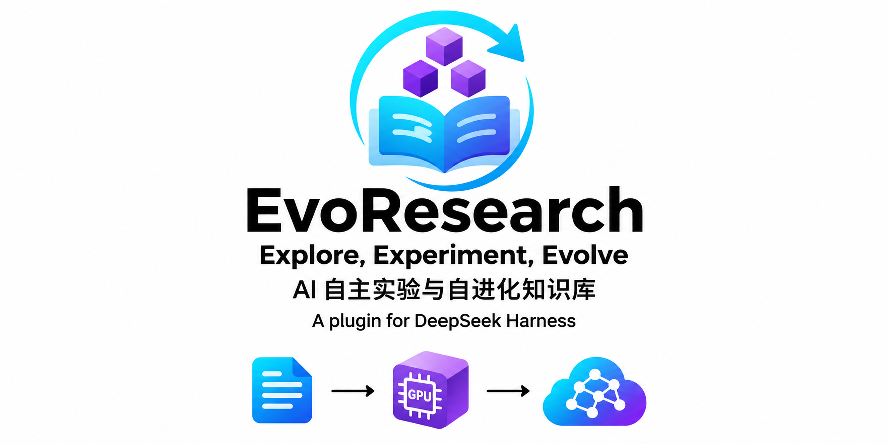
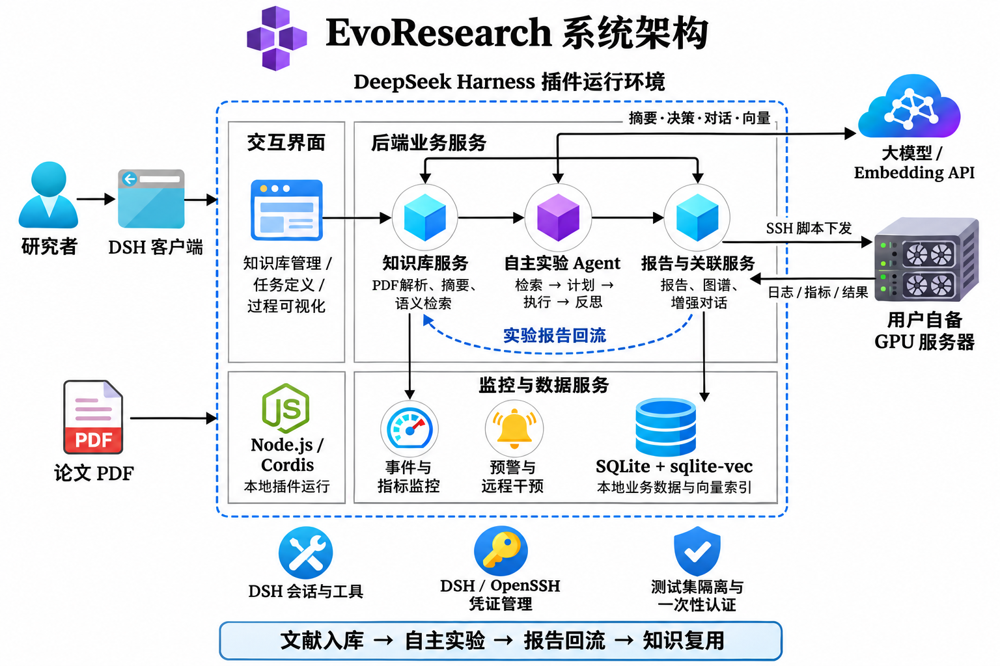

<p align="center">
  
</p>

# EvoResearch

当前集成分支的安装、共享数据库及验证边界见 [第一批共享基础设施整合记录](docs/开发工作安排/共享基础设施第一批整合.md)。本批暂停 SSH；F7 源码保留但不加载。前端与 F12 已纳入组件构建和回归，尚未接入公共运行入口。

EvoResearch 是基于 DeepSeek Harness（DSH）的 AI 自主实验与自进化知识库插件，面向机器学习与人工智能科研，连接“读文献—做实验—沉淀结论—复用知识”的流程。

- **AI 自主实验**：定义研究任务，通过 SSH 接入用户自备的 GPU 服务器，由 Agent 检索知识、执行实验并迭代调整，展示实验过程与指标。
- **自进化知识库**：支持论文导入、自动摘要、语义检索与文献图谱；实验报告自动回流，并为后续实验和 DSH 对话提供带来源的参考。


## 插件骨架（第 4 周）

运行环境为 Node.js ≥22.19.0、DSH 0.2.1-rc.2。源码位于 `src/`，TypeScript 编译为 ESM；`cordis.patch.yml` 是 DSH bundle 的加载入口。`migrations/` 用于各模块提交 SQLite 建表脚本。插件数据库由 `better-sqlite3` 管理，`sqlite-vec` 留给后续 F3 检索使用。

依赖以实际 DSH 0.2.1-rc.2 宿主为准：`dsh-tools` peer 使用 `0.2.1-rc.2`，`schemastery` peer 接受宿主的 `3.18.5`。若按旧版本号安装 SSH provider，npm 会报 peer 依赖冲突。

```sh
npm ci
npm ci --prefix modules/frontend
npm run check
npm run build
npm test
```

在已安装 DSH 0.2.1-rc.2 的机器上，将本 checkout 链接到一个临时 profile：

```sh
dsh plugin --profile evoresearch-dev add .
dsh --profile evoresearch-dev --dump-config
```

配置输出中应出现 `evoresearch-plugin`。也可安装到现有的 `web` profile，再执行 `dsh web --no-open`；在 DSH 对话中调用 `evoresearch_status`，应返回 `EvoResearch plugin is ready (week 4 skeleton).`。开发时先执行 `npm run build`，再启动 DSH。`npm test` 会检查编译后的插件入口可以注册并调用该功能。

参照 `.env.example` 将数据库路径设置到启动进程的环境变量；本项目不会自动加载 `.env`。不要提交 `.env`、SQLite 数据库或凭证。当前集成入口不启用 SSH。
项目计划采用 10 周增量迭代开发，详见 [项目立项报告 v3.0](docs/项目立项报告_v3.0_20261118.docx)。

## 系统架构



## 第四周 F1/F2

运行、接口示例与验证边界见 [F1/F2运行与验收记录](docs/开发工作安排/F1-F2运行与验收记录.md)，新增约定见 [接口契约补充建议](docs/开发工作安排/F1-F2接口契约补充建议.md)。业务REST需要DSH Web宿主的认证会话；第五周语义检索尚未实现。


F2 默认复用 DSH 的 `agentDefaultModel.currentSelection()` 和 `ctx.llm.stream()`，不读取或管理 API Key。`.env` 中的 `EVORESEARCH_SUMMARY_PROVIDER` / `EVORESEARCH_SUMMARY_MODEL` 留空即可；同时填写为显式覆盖，只填写一个会报错。每次摘要执行开始时固定模型与 reasoningEffort，后续任务读取最新 DSH 默认值。配置步骤见 [F2默认模型继承验证](docs/开发工作安排/F2默认模型继承验证.md)。

## UC01 后端（2026-11-25）

当前论文流程为：选择或继承 DSH 模型 → 上传并生成待确认摘要 → 修改/重新生成 → 确认入库。
旧 F1/F2 文档中的“先确认、后摘要”仅作为历史验收记录保留，不能用于当前 API 调用。
批量上传采用逐篇 POST 汇总；批量确认、版本冲突、模型配置及旧数据升级规则见
[UC01 后端实现与验收](docs/开发工作安排/UC01后端实现与验收.md)。本轮未接入前端，未执行付费模型请求；索引/图谱仅写入持久待处理事件。
