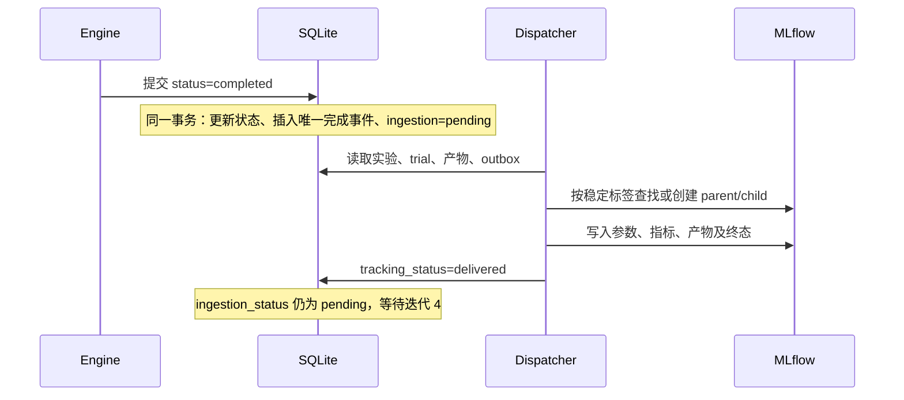

# 第三阶段实现说明（九号设计的迭代 3 补充）

MLflowAdapter 实现 ExperimentTrackerPort。一次业务 run 对应一个 MLflow parent run，终态 trial 对应 child run。源记录由 AutoResearch Store 管理，MLflow 是可重建的追踪视图。

完成事件含 event_id、project_id、run_id、successful_trial_ids 和 schema_version。事件负载创建后不可变；完成状态重复写入通过唯一 run_id 去重。事件创建时试验结果已经存储，最终报告可能尚在 finally 中生成，因此 worker 在 Engine 返回后才同步完整产物。外部 sync-tracking 即使提前同步，源记录/产物指纹变化后仍会再次同步。

查询 API 分别返回 status、completion_event.tracking_status、ingestion_status、mlflow_run_id。单机 dispatcher 文件锁防止并发创建；远端提交成功、本地映射未落库时，通过稳定标签恢复 run；指标历史按固定 step 检查，重放不增加重复点。

知识入库没有在本阶段执行，pending 不代表已写入 Graphiti。下一阶段消费者应有独立处理记录，不应把 MLflow delivered 作为知识已入库。GraphitiAdapter 继续承担知识写入、图谱查询、混合检索与可见性检查。五轮计划不变，不新增 LightRAG。
