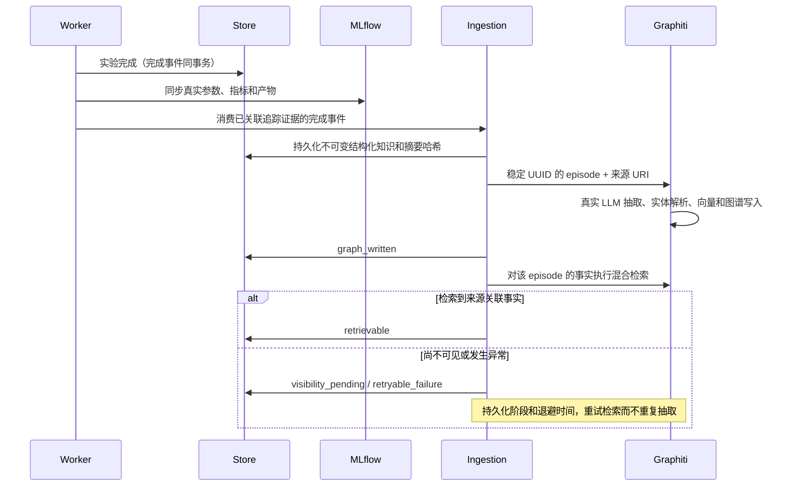

# 第四阶段：实验知识入库

在第三阶段的 completed + outbox + ingestion=pending 原子提交之上，增加独立知识消费者。实验执行状态不会被知识消费者修改。

每次完成实验形成一条 KnowledgeRecord：包含真实 trial 指标、代码 SHA256、实验与 trial 实体、关系，以及事件和 MLflow parent/child URI。摘要由真实 Store 数据确定性生成；模型假设不转述成已验证结论。最终评估属于被选定候选，不错误分配给所有 trial。

GraphitiAdapter 同时实现 KnowledgeGraphPort、RetrieverPort 和 KnowledgeIndexPort。向量由本地 BAAI/bge-small-en-v1.5 模型产生，Graphiti 执行图谱维护、全文与向量融合检索（RRF）；没有单独 RAG 框架或索引服务。当前验收使用英文结构化实验摘要；多语言检索质量留后续评估。

Graphiti 0.31.2 的 add_episode(uuid=...) 会读取已存在的 episode。适配器先用确定性 UUID 持久化原始来源，再调用 add_episode；Graphiti 的 Neo4j 事务同时保存抽取结果及 episode.entity_edges。进程在远端提交后、本地确认前退出时，重试发现已有 entity_edges，直接进入可见性检查。只有空壳 episode 不视为写入成功。内容或项目冲突会被拒绝。

SQLite event_id/run_id 唯一键和 ingestion.lock 串行化当前状态目录的消费者。项目按 SHA256 group_id 分区，查询始终带 group_id。这里不承诺多个主机或多个状态目录同时投递相同源事件的分布式 exactly-once。

可见性检查不是节点存在性检查：它必须通过 Graphiti.search 返回属于该 episode 的边。常规查询也通过同一个 GraphitiAdapter，并返回映射到 KnowledgeRecord 与 MLflow 的来源。

失败仅保存异常类型，不保存可能含密钥的后端错误字符串。按 2、4、8…秒递增退避，上限 256 秒，持久化 next_attempt；人工 --replay 可立即重试失败或待可见记录，已 retrievable 的记录不会重复入库。第三阶段 MLflow 异常也不会改写 completed。

本阶段只支持新建独立 phase4 数据目录。论文导入、论文与历史实验联合检索辅助规划、前端均未提前实现；五阶段计划保持不变。
