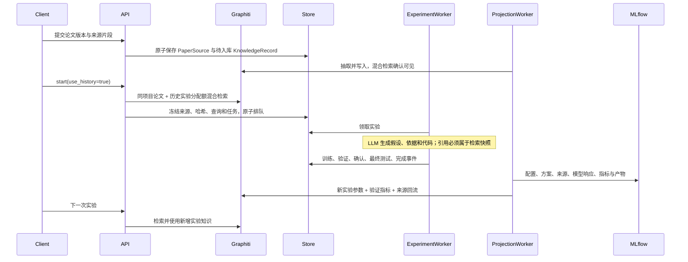

# 第五阶段后端闭环

本阶段统一 Graphiti 的论文和实验知识检索，将来源快照传入 AutoResearch 的 task_notes，并在真实模型提案中验证引用。Graphiti 仍是唯一图谱与混合检索框架，没有 LightRAG。

## 来源与引用

论文以 project_id/paper_id/version 为唯一键，同版本内容变化返回 409。接收调用方提供的片段与文献 URI、文档 SHA256，并保存片段 SHA256；服务不自行抓取任意外部 URL。验收脚本从官方版本页获取内容并核验摘要后生成明确标为 paraphrase 的入库文本。PaperSourcePort 的本地实现返回保存的来源快照。

论文与实验共用 evo_knowledge 状态机，paper 的 run_id 为空；来源键包含项目防止跨项目冲突。Graphiti 原始 episode 保留完整 KnowledgeRecord，包括文献 URI 或 MLflow 来源。

GraphitiAdapter.retrieve_joint 分别检索 paper 与 experiment 的边，各占约一半结果配额；每部分均执行 Graphiti 的向量和全文融合排序。只检索当前项目、已确认 retrievable 的记录。常规语义排序不保证相关性或普遍性能提升，跨数据集的经验仍需重新验证。

工作流按记录合并事实，限制数量与长度，在 start 事务内冻结 source_id/type/text/uri/sha256 和查询。重复提交首先查幂等映射，不重新检索；两次并发请求最终由同一事务唯一键决定并保留首个快照。use_history=false 不调用知识库、不携带 task_notes。增强请求检索不可用或空结果返回 503，不静默退化为普通实验。

模型必须返回 hypothesis、rationale、完整代码、source_ids、feedback_ordinals；引用 ID 必须属于提供的上下文。只要某种来源类型进入快照，就必须至少引用该类型的一条来源。此校验能验证引用范围与覆盖，不能自动证明模型的语义理解；验收另外检查真实 rationale、参数选择、代码差异和执行结果。

历史知识只含候选验证指标和实际参数，不把最终测试结果注入搜索上下文。最终评估仍保存于 MLflow 供审计。当前约束模板只允许 AST 白名单参数变化，检索文本不会扩大执行权限。

## 独立调度

experiment worker 只负责原 Engine 领取和执行，既不导入 Graphiti，也不调用 MLflow 同步。projection-worker 使用自己的进程与锁，依次处理 MLflow、知识写入与追踪标签更新。长 Graphiti 调用会延迟知识可用时间，但不占用 experiment worker 锁。真实验收在独立子进程持续持有 ingestion.lock 时完成增强与对照训练。

知识增强请求的首次同步检索仍会等待 Graphiti；它不在实验 worker 内，也不计入实验搜索预算。对照报告区分固定实验预算与知识准备成本，不能把两者称为完全相同总成本。

## 验收边界

一个真实论文摘要来源、一个历史种子实验、同预算增强/对照各一次，以及回流后的下一次增强实验。小样本对照用于验证功能和记录结果，不支持统计显著性或总体优越性结论。没有新增前端，也没有宣称完成任意 PDF 全文自动解析、多语种质量评测或跨机器分布式 exactly-once。
