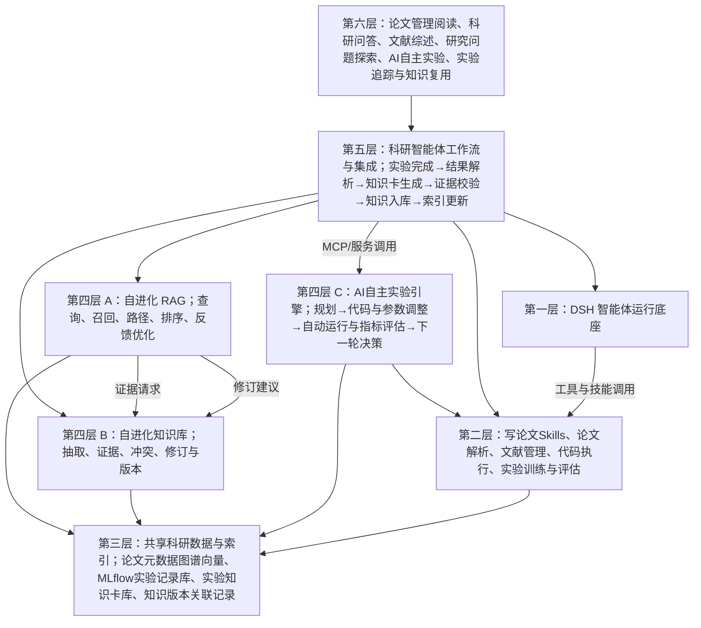
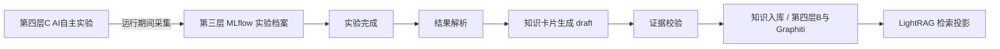

# 科研知识管理与智能研究平台：整体架构与开源集成方案

日期：2026-10-16。最新架构基准为 [5.svg](../框架图（数字为更新顺序）/5.svg) / [5.png](../框架图（数字为更新顺序）/5.png)。共核验九个指定/候选仓库：原七项、官方 MLflow，以及 AI 自主实验候选 `wjh669939-cmd/aero-scar`。其他方案及旧图为历史材料；实现路线以图 5 的六层和第四层 A/B/C 分工为准。

**作者与项目授权确认（2026-10-16）**：用户确认 aero-scar/EvidLoop 及对应论文、EvoRAG 均为本人创作，并授权本项目使用、修改与集成。因此这两项按作者自有代码推进适配，不再将仓库未附全局许可证列为本项目内部集成阻塞。技术可用性仍以实际测试与验收为准。

## 1. 结论与验证边界

这套方案可以作为开发方向，但九个项目不能直接拼接成完整产品，也不要求全部成为运行依赖。推荐采用 **DSH 运行科研智能体、Zotero 提供文献入口、CCFA 提供科研技能、Graphiti 维护时序关系、LightRAG 提供检索能力、复用并适配 EvoRAG 的反馈归因与关系评分代码、MLflow 保存实验记录与产物**。第四层 C 的 AI 自主实验引擎参考 Closed-loop Auto Research，比较 autoresearch 的执行循环与作者自有 aero-scar/EvidLoop 的单轴实验、评测和谱系实现，再通过适配器接入；暂不把两个循环串联，也不替换 DSH 底座。

真正需要自己实现的是：统一证据和业务数据模型、Graphiti 到检索索引的可靠同步、检索反馈归因适配、知识修订审核、实验评测隔离、实验记录到知识卡的转换，以及科研业务工作流。它们不是几个补丁就能完成的工作，而是本项目的主要代码与创新载体。

本次已经下载并检查九个源码仓库，锁定提交版本。既有验证：Zotero 24 项、CCFA 50 项行为测试及结构检查、Graphiti 25 项、LightRAG 111 项通过；EvoRAG 隔离数值检查、DSH Web 启动和 MLflow 本地记录/知识卡草稿导出通过。aero-scar 的证据表复算通过，补充 Windows 子进程环境的本地适配后四轴合成闭环通过；原样历史 CLH 测试有失败、工具层有目录路径问题，不能列为开箱即用的完整实验引擎。具体诊断见详细方案。**尚不能宣称九个项目均已端到端跑通，也不能宣称已证明自进化效果。** 精确命令、退出码和输出见 `audit/`。

## 2. 开源组件的取舍

| 组件 | 可以承担的职责 | 不能直接覆盖的要求 | 集成判断 |
|---|---|---|---|
| Zotero Research Assistant | MCP 文献检索、Zotero 条目交互、PDF 文本解析、分块与语义检索入口 | 独立论文阅读工作台、选区精确定位、完整 OCR、统一科研知识版本 | 保留文献连接能力；其内部 RAG 先用于基线和迁移，避免长期建设两套主检索 |
| CCFA-Skills | 科研技能提示、触发规则、材料与产物约定、连续性检查脚本 | 常驻调度服务、实际训练执行、自动证明结果可信 | 按需加载技能，DSH 执行；工作流服务保存业务状态 |
| claude-code-autoresearch | 实验初始化、命令执行、指标解析、结果日志、保留/丢弃机制 | DSH 原生科研闭环、远程训练平台适配、独立留出评测 | 通过适配器复用协议和可用实现；移植 Claude 专属 hooks；实验目录必须隔离 |
| DSH | 智能体运行、模型和工具调用、会话、技能、MCP、可组合插件 | 研究任务领域模型、知识库业务语义、课程项目的科研前端 | 已确定底座；通过插件和 SDK 扩展，避免修改核心循环 |
| Graphiti | episode 增量处理、实体关系、事实时间和历史、搜索 | 科学证据等级、适用条件下的矛盾判断、完整知识卡版本与审批 | 负责时序事实图；业务证据与修订记录独立保存 |
| EvoRAG（作者自有、已授权） | 路径效用到三元组贡献的反馈优化机制 | 即插即用的轻量服务、通用用户差评归因、知识真实性判断 | 可直接推进代码拆分与适配；接入第四层 A 的反馈归因与关系评分接口 |
| LightRAG | 图与向量检索、上下文检索、生成、多种存储后端 | 与 Graphiti 自动共享数据结构、按科研证据条件判断关系、完整反馈学习 | 用独立适配器接入；图索引作为可重建投影 |
| MLflow | 记录实验参数、指标历史、代码快照与模型等产物；部分框架支持自动记录 | 自动推导科研结论、判定泛化有效、直接写入 Graphiti/知识库 | 作为实验证据档案；完成后由自研适配器提炼知识卡并回写 |
| aero-scar / EvidLoop（作者自有、已授权；技术候选） | 历史 CLH 单轴试验、独立评测、谱系、冻结候选与留出报告；公开证据表复算 | 完整真实训练/封存数据复现包、DSH 原生插件、MLflow/知识库连接 | 可直接推进第四层 C 的代码改造；修复兼容与路径问题后，按真实任务验证采用范围 |

仓库列表与 SHA 见 [版本锁定记录](../audit/upstream-lock.json)。以上是源码审阅后的职责分配，不代表上游承诺兼容这套系统。

## 3. 六层结构

六层是职责划分，不要求每个调用逐层穿透，也不意味着每层必须单独部署。MVP 可以用一个业务后端、若干隔离 worker 和一个前端，减少分布式复杂度。

关键边界：DSH 保存智能体会话，业务服务保存研究任务；Graphiti 保存时序事实图，业务库保存证据与修订；LightRAG 保存服务于检索的投影。共享同一 Neo4j 实例也不能直接共用 Graphiti 和 LightRAG 的节点结构。

MLflow 的 SDK 属于实验工具侧，Tracking 元数据及产物存储对应第三层“实验记录库”。第三层另外两类记录为“实验知识卡片库”和“知识版本与关联记录”。第五层编排图中六步知识化流程，调用第四层 B 的知识抽取、证据审核与版本能力；第四层 C 管实验内的规划与迭代。实验引擎的“训练指标评估”与第五层的“知识卡证据校验”是两个不同阶段。

### 3.1 与图 5 逐层对齐

| 图中层/模块 | 本项目实现边界 | 开源能力映射 |
|---|---|---|
| 06 科研应用与工作台 | 六类入口，含 AI 自主实验与实验结果追踪/知识复用 | 自研 UI，消费下层服务 |
| 05 科研智能体工作流与集成层 | 六步结果知识化流程、任务衔接、MCP 服务连接 | 自研编排，不承担训练搜索算法 |
| 04 A 自进化 RAG | 混合检索、证据关联、结果溯源、反馈驱动优化 | LightRAG + EvoRAG 代码复用与适配 |
| 04 B 自进化科研知识库 | 抽取、跨文献融合、冲突识别、证据审核、版本更新 | Graphiti + 自研业务规则 |
| 04 C AI 自主实验引擎 | 实验规划、代码/参数变更、自动运行与指标评估、下一轮决策 | Closed-loop Auto Research 方法；autoresearch / aero-scar 候选适配 |
| 03 共享科研数据与索引底座 | 实验记录、知识卡、版本关联，以及论文/图谱/向量等共享数据 | MLflow 与业务库、图与索引 |
| 02 科研技能与执行工具 | 写论文 Skills、解析、文献管理、代码执行、训练评估 | CCFA、Zotero 与执行平台适配器 |
| 01 DSH 智能体运行底座 | 任务执行与状态、工具调用、上下文与流程控制 | DSH/Cordis 插件组合，沿用既定底座 |

MCP 是图中统一协议与服务调用边界，连接工作流、工具、实验执行和知识库服务；队列、数据库事务与大文件仍通过相应后端完成。文档中的部署单元是上述职责的实现方式，不另起一套替代图 5 的架构。

## 4. 两种“自进化”分别怎样落地

### 4.1 自进化 RAG 引擎

每次回答记录查询、召回片段、关系路径、排序版本、实际提供给模型的上下文、引用和反馈。收到差评先区分召回不足、排序错误、生成错误和知识过期，再决定更新哪一部分。

第一阶段优化召回配比、路径扩展深度、重排参数和关系使用评分；不修改模型权重。EvoRAG 的贡献优化作为可选策略接入，必须保存前向使用的图版本和评分，不能事后拿已经变化的路径反推。

候选策略通过独立评测集后才发布为新版本，失败可以回滚。点赞不等于事实正确，低使用频率也不等于知识错误。

### 4.2 自进化科研知识库

每个知识单元包含原文来源、页码/选区、适用数据与实验条件、支持和反驳证据、状态和版本。新文献或实验结果先形成修订提案，再进行条件对比、证据核对与接受/拒绝；保留原版本及理由。

Graphiti 的时间失效不能直接解释为“论文结论被推翻”。不同数据集、样本、时间或评测条件下的结论应并存。用户修正也先作为有来源的新断言进入系统。

## 5. 三条完整业务链

1. **读文献与问答**：Zotero 选文献 → 导入与去重 → 解析并保存原文锚点 → 抽取知识 → 建立图与索引 → 检索 → 带引用回答 → 用户点回 PDF 页码和片段。
2. **检索与知识演化**：保存检索轨迹 → 接收结构化反馈 → 定位问题 → 产生检索策略候选或知识修订提案 → 离线评测/审核 → 发布新版本 → 查看前后变化及回滚。
3. **闭环实验与知识沉淀**：第六层发起任务 → 第四层 C 通过 DSH 与第二层工具规划、修改、运行、评估和迭代，MLflow 同步记录 → 达到预算后冻结候选并按协议认证 → 第五层接到实验完成结果 → 结果解析 → 知识卡片生成 → 证据校验 → 知识入库 → 检索索引更新。认证尚未完成时允许生成标明状态的草稿，不宣称最终结论。

### 5.1 MLflow 接在实验结束与知识沉淀之间

这里的“实验后”指知识整理与入库发生在实验结束后。自动记录需在训练开始前启用；手动记录也要由执行器在运行期间或结束时提交，不能指望接入 MLflow 后自动补回未保存的旧实验。

知识卡保存“什么条件下做了什么、测得什么、与哪个基线相比、能支持多大范围的结论”，附 MLflow run_id、代码/数据 hash、原始指标和模型产物引用。原始日志和模型文件留在 MLflow 产物存储；知识库保存可检索的知识及来源。成功、无改进和失败实验均可留档，但只有证据支持的观察能成为知识，不能把运行成功等同于科学结论成立。

用户指定的 [闭环科研论文](https://arxiv.org/html/2606.22731v1)强调发现与独立留出认证分离。本项目借鉴这一评测原则和单轴修改约束；分子领域结果不能作为本平台有效性的证明。

## 6. 最小可用版本与实施顺序

| 阶段 | 交付物 | 通过条件 |
|---|---|---|
| P0：环境与接口 | 锁定依赖、模型/数据库连接检查、统一对象与工具字段 | 每个真实依赖有健康检查；失败有明确原因 |
| P1：文献到问答 | Zotero 导入、PDF 阅读与页码、LightRAG 基线检索、引用回跳 | 用一小组合法获取的 PDF 完成导入和有来源问答 |
| P2：图与知识版本 | Graphiti 接入、原文锚点映射、知识卡修订、同步重试 | 同一资料重复导入不重复建卡；修订可追溯可回滚 |
| P3：检索演化 | 反馈日志、路径映射、候选策略与对照评测 | 固定测试集上同时报告质量、延迟、成本和不确定性 |
| P4：实验闭环与沉淀 | 本地真实实验、独立评测、训练平台接口、MLflow 档案与知识转换 | 保留、丢弃、失败均有记录；一次完成实验可生成可溯源知识卡，重复同步不重复入库 |
| P5：产品整合 | 统一前端、翻译术语表、结果展示、导出与部署 | 新成员按部署说明可复现核心演示 |

建议先完成 P1 的可靠证据链，再把两个自进化闭环和实验闭环接上。前端、数据约定和模拟训练适配器可以同时开发；模拟结果必须醒目标记，不能进入真实实验结论。

## 7. 主要自研模块与责任

| 自研模块 | 核心代码责任 | 最重要的验收证据 |
|---|---|---|
| 科研工作流服务 | 意图路由、任务状态机、DSH 会话映射、工具输入输出验证、取消恢复 | 同一任务重试不重复创建训练作业，重启后可解释地恢复 |
| 证据与知识服务 | 文献身份、原文锚点、知识单元、条件化关系、修订版本与来源 | 每条被引用的结论能回到实际原文/实验产物 |
| 图与索引同步器 | Graphiti 结果归一、关系映射、LightRAG 投影、幂等和重建 | 中途失败可重试；删除资料后索引不会继续返回它 |
| 检索演化服务 | 反馈分型、路径效用、关系评分、策略版本与效果评测 | 改善可以被独立问题集验证，退化能回滚 |
| AI 自主实验引擎（04 C） | 实验规划、Trial 生命周期、预算、单轴代码快照、执行适配、评测与下一轮决策 | 代理无法编辑评测器或读取留出标签，所有指标来自运行产物 |
| 实验结果知识化工作流（05，调用04 B） | 按图中六步读取档案、解析结果、生成草稿、校验证据、幂等入库、触发索引更新 | 卡片生成先于正式证据审核；审核失败不入库，失败与未认证结果不变成普适结论 |
| 科研工作台 | 阅读器、选区入库、术语翻译、引用跳转、图谱与实验展示 | 完整用户流程可操作，后台状态变化及时可见 |

## 8. 本次交付与后续边界

本次交付两版设计、源码快照、版本记录和检查脚本，当前目录已初始化 Git。下载的上游源码与隔离环境通过 `.gitignore` 排除，项目仓库保存设计、锁定清单与验证证据，避免误提交嵌套仓库和大体积依赖。

真实环境验收还需要配置 Zotero、模型与 embedding 服务、图数据库、实验数据与训练平台接口。选 autoresearch 后端时需 Ruby/Bundler；选 aero-scar/CLH 时直接按作者授权推进改造，修复路径与运行/协议问题并完成真实任务验收。EvoRAG 同样可按作者授权进行评分代码拆分与集成。两种实验后端都通过第四层 C 接口调用第二层工具；第五层继续按图5六步处理结果。详细文档给出验收步骤。本阶段没有实现业务产品，也没有对尚未运行的能力作成功承诺。
