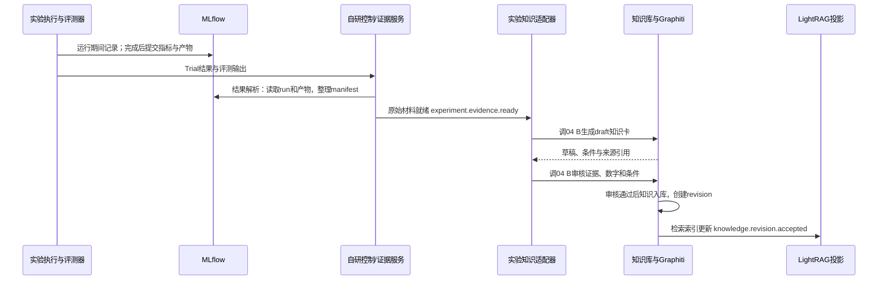

# 科研知识管理与智能研究平台：源码核验与详细集成设计

日期：2026-10-16。本文核验九个指定/候选仓库（含 MLflow 与 `wjh669939-cmd/aero-scar`），最新架构基准为 [5.svg](../框架图（数字为更新顺序）/5.svg) / [5.png](../框架图（数字为更新顺序）/5.png)。MLflow 负责实验档案；aero-scar/EvidLoop 仅作为第四层 C 的候选。以下区分 **已观察到的实现**、**实际验证结果** 与 **拟实现设计**；接口设计示例不代表代码已经存在。

**作者与项目授权确认（2026-10-16）**：用户在本会话明确确认 aero-scar/EvidLoop 及对应论文、EvoRAG 均为本人创作，并授权本项目使用、修改与集成。两者按作者自有代码推进，不再把缺少仓库全局许可证列为本项目内部代码改造与集成的阻塞。“候选”仅表示技术选型与验收状态，不能解释为等待作者许可。本次没有修改上游公共许可证或第三方依赖的使用条件。

## 0. 图 5 的架构约束

| 图中位置 | 本文实现责任 | 明确边界 |
|---|---|---|
| 06 科研应用与工作台 | 论文管理与阅读、科研问答、文献综述、研究问题探索、AI 自主实验、实验结果追踪与知识复用 | UI 调服务，实验算法不放前端；翻译/术语保留为阅读增强，不替代图中主入口 |
| 05 科研智能体工作流与集成层 | 实验完成 → 结果解析 → 知识卡片生成 → 证据校验 → 知识入库 → 检索索引更新 | 组织六步并处理任务与重试，不成为另一个训练搜索引擎 |
| 04 A 自进化 RAG 引擎 | 混合检索、证据关联、溯源与反馈优化 | LightRAG/EvoRAG 适配，不负责训练 trial 决策 |
| 04 B 自进化科研知识库 | 知识抽取、融合、观点冲突识别、证据审核、版本更新 | Graphiti + 知识业务规则，供第五层调用 |
| 04 C AI 自主实验引擎 | 规划、代码与参数调整、自动运行、指标评估与下一轮决策 | 自研实验引擎接口，比较 autoresearch 与 aero-scar，不替换 DSH |
| 03 共享科研数据与索引底座 | 实验记录库、实验知识卡片库、知识版本与关联记录；共享论文/元数据/图谱/向量 | MLflow 对应实验记录库，知识卡与图谱是额外数据模型 |
| 02 科研技能与执行工具 | 写论文 Skills、论文解析、文献管理、代码执行、实验训练与评估 | CCFA、Zotero、训练平台/本地执行适配 |
| 01 DSH 智能体运行底座 | 任务执行与状态、工具调用、上下文与流程控制 | 沿用 DSH/Cordis；CLH 同名 harness 不是 DSH 的替换底座 |

MCP 是统一协议与服务调用边界。DSH 的运行状态、04 C 的 Experiment/Trial 状态、05 的知识化任务状态分别管理并建立映射。05 调 04 C 发起实验，04 C 调 02 执行并写 03；实验完成后 05 调 04 B 生成卡片和审核，04 B 更新 03，04 A 使用已发布知识与索引。这些是职责关系，不要求每层独立部署。

## 1. 核验方法与可复现材料

### 1.1 核验等级

| 等级 | 含义 | 不能证明什么 |
|---|---|---|
| S：静态审阅 | 阅读核心函数、配置、依赖与测试；Python 源文件做语法解析 | 不证明能导入、启动或正确工作 |
| I：安装/导入/入口 | 隔离环境安装、模块导入或 CLI 帮助正常退出 | 不证明服务可用、模型调用成功 |
| U：离线/模拟检查 | 执行指定上游测试或隔离数值检查 | 不证明数据库、模型与真实业务兼容 |
| E：真实端到端 | 真实数据、服务和依赖完整运行且核验产物 | 本次没有完成全系统 E 级验收 |

所有仓库位于 `upstream/`，完整提交号、仓库 URL、许可证原文与 Python 语法扫描结果保存在 [upstream-lock.json](../audit/upstream-lock.json)。用 `python scripts/audit_sources.py` 可重新生成。语法扫描针对当前 Python 3.11，不把 Ruby 或 TypeScript 当作已经编译验证。

### 1.2 锁定版本

| 项目 | 仓库 | 本次源码提交 |
|---|---|---|
| Zotero Research Assistant | [qiobn/zotero-research-assistant](https://github.com/qiobn/zotero-research-assistant) | `8bebcc2b072ea243d43c7decd49fcf08ba4f7d15` |
| CCFA-Skills | [mikubaka88/CCFA-Skills](https://github.com/mikubaka88/CCFA-Skills) | `14591f9663cb5a664dc8061618c7cc28d1a7356d` |
| claude-code-autoresearch | [marcelopazzo/claude-code-autoresearch](https://github.com/marcelopazzo/claude-code-autoresearch) | `109c0e1996ec88eac76ba9c7db72acaf00840ced` |
| DSH | [deepseek-ai/deepseek-harness](https://github.com/deepseek-ai/deepseek-harness) | `86a402200d95fecef4529d969836f1fe13c6cb0d` |
| Graphiti | [getzep/graphiti](https://github.com/getzep/graphiti) | `dd3fd6ca7671c90b299fe8e8867a9f8439eafbeb` |
| EvoRAG | [iDC-NEU/EvoRAG](https://github.com/iDC-NEU/EvoRAG) | `6b958cb660b7ff43ed5edfbf47cbe8d983998b6d` |
| LightRAG | [HKUDS/LightRAG](https://github.com/HKUDS/LightRAG) | `aaebfe1bb8d55deb6a4304d357a3bf4c92fcd40a` |
| MLflow | [mlflow/mlflow](https://github.com/mlflow/mlflow) | `d5a65b716b74518f89350d60bf1111ea6eba830f` |
| aero-scar / EvidLoop（候选） | [wjh669939-cmd/aero-scar](https://github.com/wjh669939-cmd/aero-scar) | `3a2e44e679ab1e96aa14059a1fd3211323421de4` |

DSH 额外安装了 npm 发布包 `@deepseek-ai/dsh@0.2.0-rc.2` 做 CLI 检查。**发布包启动验证不等于本次 Git HEAD 已源码构建通过**；两种版本的证据分开记录，开发前必须统一。

### 1.3 当前环境

Windows、Python 3.11.5、Git 2.51.1。默认 PATH 上 Node 为 14.21.3，不符合 DSH 的 Node 要求；本次使用已有的 bundled Node 24.19.0 启动 DSH 发布包。Python 测试依赖放在 `.audit-venvs/`，DSH 放在 `.audit-runtime/dsh/`。没有修改全局 Python 或 Node 版本。

Docker 客户端存在，但 `docker info` 无法连接 Docker Desktop Linux Engine；Ruby、Bundler 在 PATH 中未找到。因此不能把数据库集成或 Ruby 实验服务标为通过。没有读取或调用用户模型密钥，也没有访问私人 Zotero 数据或启动付费实验。

### 1.4 实际检查结果

| 项目 | 本次通过项 | 仍未验证 |
|---|---|---|
| Zotero Research Assistant | 完整依赖安装；MCP 模块导入；分块 3 项、辅助函数 21 项，共 24 项测试 | 模型预加载、MCP 实际会话、Zotero 私人库与在线检索 |
| CCFA-Skills | 17 技能结构检查；连续性 23 项、偏好 27 项，共 50 项行为测试 | 模型执行技能后的科研产物质量 |
| claude-code-autoresearch | 源码与接口检查 | Ruby 安装、测试、MCP 启动与完整实验循环 |
| DSH | 发布包 CLI、Web profile 加载；实际 Web 服务启动，持有登录 Cookie 后首页 HTTP 200 | 本次 Git HEAD 源码构建、真实模型与科研插件联调 |
| Graphiti | 依赖约束后 25 项离线测试 | 真实数据库、模型抽取与增量图更新 |
| EvoRAG | Python 语法解析；原方法隔离数值 smoke；作者已确认项目使用授权 | 完整依赖、模型/GPU/数据库、论文实验与服务适配 |
| LightRAG | 核心安装；111 项离线测试 | API/WebUI、真实模型/embedding、图数据库及图融合 |
| MLflow | 源码 `3.17.2.dev0` 安装；本地真实训练的显式/自动记录、代码与模型读回、失败状态、draft 知识卡导出通过 | 远程 Tracking 服务、对象存储、权限与 Graphiti/LightRAG 实际入库 |
| aero-scar / EvidLoop | 288 文件语法解析、证据表复算通过；Windows 环境适配后四轴合成闭环通过 | 原始 harness：17 通过/2 失败/4 跳过；tools：49 通过/25 失败；真实 AI、气象训练与封存认证未复现 |

Graphiti 与 LightRAG 的异步检查在沙箱内曾超时，同一测试在沙箱外通过；CCFA 的临时 Git/文件检查也需沙箱外运行。最终日志与 JSON 记录保存成功运行的命令、耗时和退出码。LightRAG 输出的 spaCy 模型提示不代表本次 111 项有失败，也不代表已覆盖需要这些模型的其他测试。

## 2. 逐项目源码核验

### 2.1 Zotero Research Assistant

**实现依据**：`project_a_mcp/server.py` 用 FastMCP 注册工具；`research_core/zotero/` 负责 Zotero 连接；`research_core/parsers/pdf.py` 的 `extract_pdf()` 逐页提取文本；`chunker.py` 中 `Chunk` 保存页码；`research_core/rag/` 包含索引、检索、重排和日志。入口 `zra-mcp = project_a_mcp.server:main`，要求 Python ≥3.11。

仓库描述、README 和实际版本之间存在工具数变化，不硬编码宣传数字。当前源码说明 39 个工具，其中 4 个由 CNKI 配置决定是否注册；最终能力发现以 MCP `tools/list` 为准。

**满足程度**：文献管理、检索与知识入口基本匹配。PDF 默认只提取文本，没有 OCR；图表主要是标题和原文块，不代表结构化表格理解。页码能支持初步回跳，但不能替代精确选区坐标。内部 ChromaDB 索引也不是 Graphiti/LightRAG 的公共数据模型。

**验证**：完整依赖安装及 MCP 模块导入成功；上游 `tests/core/test_chunker.py` 3 项、`tests/unit/test_cnki_helpers.py` 21 项通过。首次仅装解析依赖时，辅助测试曾因缺少 ChromaDB 无法导入，完整安装后解决。日志见 `audit/zotero-*.log`。没有进入会触发模型预加载的真实 MCP 生命周期，不能标为完整检索通过。

**接入**：先通过 MCP 调用元数据与文献工具；需要共享解析能力时再抽取库级适配。业务侧保留 Zotero library/item/attachment key、附件 hash 和版本号，不直接写 Zotero SQLite。写条目、笔记与标签的权限独立配置。

**E 级验收**：对测试文献库列集合、读条目、读附件、同步两次、真实语义检索、抽查中英文页码；对缺失 Zotero、扫描 PDF、无 API 权限分别检查明确错误。CNKI 单独验收，不能以普通检索通过替代。

### 2.2 CCFA-Skills

**实现依据**：`ccf-*/SKILL.md`、`ccf-common/references/skill-trigger-registry.yaml`、公共约定、`ccfa.yaml` 相关状态约定；`ccf-common/scripts/check_v04.py` 与 `test_continuity.py`、`test_preferences.py` 提供结构及行为检查。

**满足程度**：适合科研技能层。其核心是给智能体读取的规则、模板和少量辅助脚本，不是具有服务端调度与持久化保障的“科研操作系统”。能力要靠 DSH 中的模型、工具和业务环境兑现。

**验证**：自带结构校验在沙箱外重跑通过，识别 17 个技能；连续性 23 项、偏好 27 项行为测试通过。沙箱内首次失败来自临时文件/Git 仓库操作权限；不能归因于技能逻辑。见 `audit/ccfa-*.log`。

**接入**：SkillAdapter 从注册表构建技能目录，按任务挑选必要技能和公共约定，再交 DSH 加载。保存 `skill_id + upstream_sha + input_artifact_ids + output_artifact_ids`。对技能的材料前置条件和产物做验证；未提供实验数据时不能让写作技能补造结果。

**E 级验收**：用相同材料实际完成一次文献检索和实验设计；检查技能触发、材料不足时的处理、产物 schema 与来源。结构校验通过只能证明资源组织和部分约定，不证明科研质量。

### 2.3 claude-code-autoresearch

**实现依据**：`mcp/Gemfile` 要求 Ruby ≥3.1，依赖 MCP、Rack、Puma；`mcp/lib/autoresearch/tools/` 提供 `init_experiment`、`run_experiment`、`log_experiment`。`metrics.rb` 解析 `METRIC name=value`；`state.rb` 管理 JSONL；`runner.rb` 用子进程、超时与进程组控制运行命令；`hooks/`、`commands/`、`skills/` 连接 Claude Code 宿主。

**满足程度**：具备实验试错循环的实用部件，但“提出假设”仍依赖宿主智能体，不能独立替代 DSH，也不具备本项目的文献证据链与训练平台 API。`confidence.rb` 的得分不能被解释成独立统计显著性证明。

**关键限制**：`log_experiment.rb::maybe_revert_code` 会使用 Git reset/checkout/clean；keep 决策与日志输入并非独立可信的评测认证。Runner 使用 `pgroup` 和进程组信号，Windows 兼容性必须另测，推荐在 Linux/WSL worker 运行。原样把工作目录指向主项目会有丢弃未提交文件的风险。

**验证**：已审阅入口、状态、执行和回退实现；当前缺 Ruby/Bundler，没有执行 `tests/library_smoke_test.rb` 或启动 MCP。**结论为 S，不能标为可直接运行。**

**接入**：近期可以在 Linux worker 中保留 Ruby MCP，用 DSH MCP 客户端调用；将 Claude 专属 hooks 的持续循环控制改成业务 Trial 状态机。若移植到 Python，先用上游行为做兼容参照，不能宣称只是“改个入口”。所有修改仅发生在独立 trial checkout/容器内。

**E 级验收**：Ruby 安装、`bundle install`、上游 library smoke、MCP 工具发现、一个已知有益改动、一个退化改动、一个超时命令、一个失败检查；核对 JSONL、快照和回退结果。单独验证远程取消能终止子进程。

### 2.4 DSH：DeepSeek Harness

**实现依据**：`packages/sdk/client/`、`packages/sdk/server/` 提供 stdio JSON-RPC SDK；`packages/mcp/mcp-client/` 负责 MCP 服务连接、工具发现和调用；`packages/skill/` 加载技能；`packages/workflow/` 提供脚本编排；`packages/session/` 管会话持久化；核心运行通过 Cordis 插件组合。

源码 `package.json` 要求 Node `^22.19.0 || >=24.0.0`，采用 pnpm workspace。预稳定接口有变化风险，因此 SDK、协议、CLI 要成套锁版本。源码构建流程是 `pnpm install` → `pnpm run build` → `pnpm dsh web`；本次没有运行整仓源码构建。

**验证**：用 Node 24.19.0 执行发布包 CLI 与 Web profile 帮助均成功退出；实际启动 `web --no-open`，使用启动令牌建立 Cookie 会话后取得首页 HTTP 200（34,782 字节 HTML），然后结束本次服务进程。见 `audit/dsh-cli.log`、`audit/dsh-web-help.log`、`audit/dsh-web-smoke.json`。初始 HTTP 探针因未保留登录 Cookie 而失败，修正探针后通过；日志中的临时令牌已脱敏。发布包安装关闭了安装脚本，此结果不覆盖所有原生插件、交互 UI 操作或真实模型 turn。

**接入**：采用 DSH SDK/profile/patch 和自研科研工具插件。研究任务 ID 映射到 DSH session ID；对外 API 保存业务状态，DSH 仅是执行引擎。MCP 用来连接 Zotero/实验服务及自研工具，不承载整个任务队列或数据库事务。

**E 级验收**：锁定源码或发布包之一，构建/启动选定 profile；验证一次模型请求、MCP 工具调用、技能加载、会话恢复和取消。发布前跑科研插件的兼容性测试，不直接跟随 upstream main 更新。

### 2.5 Graphiti

**实现依据**：`graphiti_core/graphiti.py::add_episode()` 处理增量 episode；`search()` 检索；`add_triplet()` 处理外部三元组；`edges.py` 的事实边包含 `valid_at`、`invalid_at`、`expired_at` 等时间信息。支持定制实体/关系类型及 group 分区。Python 包版本 0.31.1。

**满足程度**：适合动态知识图谱与关系历史。它的 episode/时间机制不等价于科研知识卡版本、证据可信状态或完整人工审核。LLM 自动识别到的冲突也不等于科学结论被证伪；业务侧必须保存适用条件。

**验证与依赖问题**：完整核心安装成功。首次解析到 OpenAI 3.31.0 时其依赖图带入 httpx2，而 Graphiti 源码直接 `import httpx`，导致导入失败。本次通过明确安装 `httpx`、固定 `openai<3` 恢复测试入口。这是当前松版本依赖下观察到的组合问题，不能推广为所有 Graphiti 版本都不可运行。最终文本处理、时间边界与请求隔离共 25 项通过，见 `audit/graphiti-offline.log`；测试关闭数据库 fixture，不代表 Neo4j 集成通过。

**接入**：以 `group_id = project_id` 隔离项目。episode 绑定导入事件和来源 chunk，Graphiti UUID 通过映射表连接业务 entity/assertion IDs。不把 group_id 当作鉴权系统；服务端仍验证项目访问权限。原文、知识卡与修订历史放业务库。

**E 级验收**：启动 Neo4j 和模型/embedding，添加两段含时间变化的记录；验证新旧关系、来源 episode、重复导入、删除和项目隔离。额外准备“不同条件但并不矛盾”的科研句子，避免自动覆盖。

### 2.6 EvoRAG

**实现依据**：`llmragenv/Cons_Retri/KG_Retriever.py::retrieve_path_with_keywords_standard()` 将相关性和关系贡献组合成三元组概率并计算路径分布；`KGModify/KGModify.py::_apply_standard_autograd_update()` 基于路径效用做 autograd/SGD 更新；`feedback_process_one()` 和 `evolve_batch()` 连接检索、回答与反馈；`run_batch.sh` 驱动批处理。

**满足程度**：与“检索反馈归因、关系贡献优化”方向高度匹配。但代码和 NebulaGraph、模型、数据集、路径及 GPU 依赖耦合；依赖包括旧版 torch、vLLM、CuPy、llama-index 等。它不是可直接塞进 Graphiti/LightRAG 的评分插件。

**重要区别**：上游反馈循环可以利用数据集答案或模拟反馈；真实用户差评没有自动提供三元组级因果标签。路径效用与反馈来源必须显式保存，自动评价、人工纠错、离线标准答案不能混为同一个监督信号。

**验证**：82 个 Python 文件通过语法解析。`scripts/evorag_numeric_smoke.py` 从原文件 AST 隔离执行两个原始方法，有用路径上升、相反路径下降、数值有界和空路径处理检查通过。它不能当成整包导入、GPU、NebulaGraph 或论文复现通过。当前没有完成这些完整运行验证。

**复用方式（已获作者项目授权）**：用户确认 EvoRAG 为本人创作，允许本项目直接使用、修改和集成。可从原实现拆出路径概率、效用归因、三元组评分更新及状态保存能力，适配本项目稳定 assertion IDs、检索轨迹和 RelationScore 接口；不必因仓库未附 LICENSE/COPYING 而改走仅参考算法或暂缓代码集成。保留源码版本与改动记录，清楚标注原实现复用和本项目新增部分；完整服务可用性与真实反馈效果仍需验证。

**E 级验收**：单独 Linux/GPU 环境锁依赖；补充真实数据与图服务，跑 `run_batch.sh` 一轮；检查概率、反馈更新、保存/重载和独立测试集变化。进入产品前将评分计算与数据库、LLM 和数据集剥离，并与上游数值样例对齐。

### 2.7 LightRAG

**实现依据**：`lightrag/lightrag.py` 提供 `initialize_storages()`、`ainsert()`、`ainsert_custom_chunks()`、`ainsert_custom_kg()`、`aquery_data()` 与 `aquery()`；`operate.py` 负责图检索与上下文构建；`base.py` 和 `kg/` 定义存储及实现。本次版本 1.5.8。

**满足程度**：适合图增强检索和生成。Graphiti 的实体 UUID、时间关系、episode 与 LightRAG 的实体名称、关系和 source_id 并不兼容；不能连接同一个数据库就认为已融合。

**关键实现限制**：`ainsert_custom_kg()` 的注释明确指出该路径没有文档级持久 journal/recovery anchors，部分失败可能留下不可被常规清理发现的贡献。关系 weight 还受证据源数量等语义约束，不能把 EvoRAG 学习到的任意浮点评分直接写进去。

**验证**：核心包和指定测试依赖安装成功；查询校验及上下文截断相关 111 项离线测试通过，原始记录见 `audit/lightrag-offline.log`。这些检查不覆盖真实模型、embedding、API/WebUI、数据库或自进化效果。

**接入**：Graphiti/业务知识为事实来源，LightRAG 为派生检索索引。首次采用独立 shadow workspace 构建完整投影，校验后原子切换业务侧指针，失败丢弃候选；不要在唯一线上索引原地导入自建图。高规模增量方案再设计自有 journal、anchor 和后台修复。

**E 级验收**：真实 embedding 与 LLM、实际 PDF/chunks、至少一次 hybrid/mix 检索和可核验回答；抽查关系到原文映射、删除重建、中断后恢复和新旧索引切换。

### 2.8 MLflow：实验档案与实验后知识来源

**实现依据**：`mlflow/tracking/fluent.py` 提供 `start_run()`、`log_params()`、`log_metrics()`、`log_artifact(s)()` 和通用 `autolog()`；`mlflow/tracking/client.py` 提供 run 查询、指标历史、产物列表/下载和模型查询；`mlflow/sklearn/__init__.py` 提供框架 `autolog()`、`log_model()`、`load_model()`；`mlflow/store/tracking/sqlalchemy_store.py` 保存数据库后端记录，`mlflow/store/artifact/` 连接产物存储。`tracking/context/git_context.py` 采集可识别的 Git 上下文，但 Git commit 元数据不等于完整代码快照。

**运行条件**：本次 Git HEAD 的开发版本为 `3.17.2.dev0`，要求 Python ≥3.10。已从仓库根目录源码安装到 `.audit-venvs/mlflow/`，不是拿另一个 PyPI 版本代替。生产版本应另选并验证稳定发布；当前快照只作为本次检查依据。SQLite/本地文件足以验证单机记录链，团队部署采用独立 Tracking 元数据库与共享产物存储。`libs/skinny/` 依赖源码符号链接，普通 Windows checkout 可能将其变成文本；本次从根目录安装，未修改上游文件。

**满足程度**：适合用户补充的“每次实验跑了什么、结果怎么样”。既能显式记录参数、指标、步骤和产物，也能为受支持框架采集部分内容。源码中的 sklearn autolog 在 `fit/fit_predict/fit_transform` 时触发，因此要在训练前启用。自定义训练框架、独立评测器、自定义业务状态与完整代码快照需要显式记录。官方 [Tracking API](https://mlflow.org/docs/latest/tracking/tracking-api/) 与 [自动记录说明](https://mlflow.org/docs/latest/ml/tracking/autolog/) 可作为使用入口；具体行为以本次源码和框架版本验证为准。

**职责边界**：MLflow 管实验档案；autoresearch 管试错执行与保留/丢弃；评测器产生指标；DSH 管智能体运行；自研 ExperimentKnowledgeAdapter 把完成档案转换为知识提案。MLflow `FINISHED` 只表示该 run 正常结束，不等于指标更好或通过泛化认证。原始记录不是自动获得证据等级的科研结论，模型注册也不是知识入库。

**验证设计与证据**：`scripts/mlflow_smoke.py` 使用固定种子生成小数据，进行实际 Ridge 训练，写 SQLite 和本地产物，验证参数/逐步指标读回、父子 run、代码产物 hash、模型预测读回、sklearn 自动记录、失败状态，以及实验结束后依据 manifest 导出带来源的 draft 知识卡。结果见 `audit/mlflow-smoke.log`、`audit/mlflow-smoke-result.json` 和实际依赖 `audit/mlflow-environment.txt`。这是自编本地集成检查，不冒称上游完整测试通过；知识卡为 `fixture_only`，没有写入真实 Graphiti 或 LightRAG。

**实际结果**：上述五组本地集成检查全部通过，测试从 `upstream/mlflow/mlflow/__init__.py` 加载源码。2,775 个跟踪的 Python 文件语法解析通过。第一次 sklearn 自动记录遇到 Windows 默认 GBK 解码错误，参数已有记录但指标不完整，因此明确判失败；用 `python -X utf8` 重跑后参数、训练指标与模型均通过断言。初始失败日志保存在 `audit/mlflow-smoke-initial.*`，最终通过记录为 `audit/mlflow-smoke.*`。部署时固定 UTF-8 模式，并验证完整记录，不能只看到训练退出 0 就假定 autolog 成功。测试过程中只加载本次自行训练的模型，没有执行未知来源模型。

**接入**：每个 trial 映射一个 MLflow run；可选父 run 汇总同一研究实验。设置 project/task/trial/job IDs 标签，并保存 run_id 到业务库。实验控制器在指标和产物完成上传、manifest 校验后产生 `experiment.evidence.ready`；知识适配器再读取并提炼。MLflow 3 的模型可有独立 model_id，使用 `log_model()` 返回的 URI/model_id，不假定所有模型固定存于某个 run 的 `artifacts/model` 路径。

**E 级验收**：真实训练 worker 向远程 Tracking 服务提交一轮实验，业务端按 run_id 读回并下载核验产物；完成后生成知识卡，验证其条件、指标、基线和引用；Graphiti 可查到实验观察，LightRAG 回答可追溯到 run/产物。再验收重复通知、缺产物、上传中断、失败 trial、无基线、不同数据划分、认证更新及跨项目权限。本次本地 smoke 不替代这些验收。

### 2.9 aero-scar / EvidLoop：第四层 C 的候选机制

**身份与发布范围**：仓库当前名称是 EvidLoop，AeroWF-SCAR 是历史名。根 README 与 `releases/evidloop-paper-v1/DATA_ACCESS.md` 明确将历史实现、论文证据和不公开的训练/封存资料分开。本次源码提交见上表；公开仓库并不是完整气象训练与认证重放包。不能将论文表格复算成功等同于复现实验结果。

**实现分成三套材料**：

| 部分 | 源码与可复用思想 | 本次边界 |
|---|---|---|
| `harness/` 历史 CLH，包版本0.1.0、Python≥3.11 | `research/loop.py` 五步循环；`cards.py` 假设/动作/Trial；`axis_lock.py` 单轴文件修改；`evaluator.py` 与 `subproc.py` 分离执行和评分；`certification.py` 冻结候选、生成留出报告 | 有 dummy 合成气象和 AeroWF profile；offline 是固定脚本研究者，不是真实 LLM |
| `tools/contract_tools/` 与 `contract/` | 结构校验、提案解析、谱系、假流水线校验、真实训练命令适配与评测客户端 | 部分代码/测试仍找 `00_contract`，实际目录是 `contract`；runner 还带历史机器路径 |
| `releases/evidloop-paper-v1/` | CSV/JSON 证据与复算脚本 | 可检查公开统计的一致性，缺少原始真实训练和封存评测所需材料 |

**实际验证结果**：

- 288 个跟踪 Python 文件通过3.11语法解析；同源码构建的普通 wheel 可安装和导入。初次 editable 安装在本机中文路径下未使 clh 可导入，改普通 wheel 后解决，未修改上游文件。
- `harness/tests` 原样：17 通过、2 失败、4 跳过。4 项因未挂载 AeroWF 数据而跳过；2 项涉及 Ridge/合成闭环的子进程。首次默认临时目录还有权限问题，改用项目内唯一临时目录后才得到上述源码运行结果，不能把最初环境错误算成源码缺陷。
- `tools/tests` 补齐 jsonschema 后：49 通过、25 失败，失败中存在对不存在的 `00_contract` 目录的引用。已经存在的通过项也只是相应工具/假流水线检查，不代表真实训练跑通。
- `recompute_tables.py` 返回0、ALL PASS；这是公开证据表及记录门槛的复算，未重新训练或访问封存标签。
- 原始 dummy CLI 虽能退出0，模型 trial 实际失败，因此 smoke 明确判失败。对照诊断发现 `_clean_env()` 遗漏 Windows 系统环境时，sklearn → joblib → asyncio → `_overlapped` 导入出现 WinError10106；补充 SystemRoot/WINDIR、临时目录和UTF-8后同一导入成功。
- 仅在本地内存适配器中修正子进程环境，四轴合成闭环通过：4个 trial，模型轴 improved，其余 no_gain，生成 temporal/spatial/event 报告。上游源码保持不变。`OfflineLLM` 是预设动作，故这证明“适配后执行与记录链可跑”，不证明 AI 的实验发现能力，更不是正式气象认证。

原始/适配结果分别见 `audit/aero-harness.*`、`aero-tools.*`、`aero-evidence.*`、`aero-dummy.*`、`aero-dummy-adapted.*`；Windows 对照见 `aero-windows-probe-result.json`。测试不是全绿，文档不以适配结果覆盖原始失败。

**集成前需要处理的具体问题**：

1. 将历史目录、机器路径、AeroWF 数据和执行参数变为部署配置；修复 `00_contract` 引用，并验证真实训练和取消语义。`DomainAdapter` 是好的抽象起点，但当前领域、端点、动作与训练文件仍与气象任务绑定。
2. 子进程与环境白名单并不等于 OS 权限隔离，不能由“不给模型看标签”推出文件系统也不可读。真实评测器与封存数据需按现有设计隔离权限，trial 超时也要验证进程树终止；本次没有执行不可信 trial 代码或访问私人数据。
3. `LLMConfig.api_key` 是普通字符串，CLI 将 `config.model_dump_json()` 写入 `config.resolved.json`。占位字符串探针证实该字段会明文序列化；接入真实服务前必须把凭据改成外部引用并脱敏配置/归档，不能把原始配置上传 MLflow。未读取、展示或使用仓库历史密钥。
4. `research/evidence.py::adjudicate()` 当前把 `negative_ok` 固定设为 True；不能将 `negative_control_ok=True` 当作真正运行过负对照的证明。需要独立负对照结果及来源，缺失就标未检验。
5. `certification.py::_route_split()` 对未选中轴的端点写0，但聚合只平均被选中的端点。合成双端点探针得到报告0.10，而包含基线回退端点的全端点均值为0.05。若本项目要求固定端点等权汇总，必须修正分母并记录协议版本；不能直接沿用该 aggregate。
6. 用户已确认 aero-scar/EvidLoop 及对应论文为本人创作，并授权本项目直接改造集成。因此不再因缺少仓库全局 LICENSE 而暂缓代码复用。当前公开快照缺少的数据、模型与封存材料仍是运行所需输入问题，不能由代码授权推导为这些文件已经到位；后续按实际提供的材料接入。

第3/5项的可复核结果见 `audit/aero-protocol-findings.json`；探针只使用占位字符串和合成分数。未把这些历史实现问题推断为论文证据包数值错误。

**与现有组件的分工和采用建议**：

| 组件 | 放在图5哪里 | 是否替代 |
|---|---|---|
| DSH | 01 智能体运行，加载科研插件/工具 | 保持既定底座，CLH 自定义 Python context/event 不能当作 Cordis 插件直接装入 |
| autoresearch | 04 C 的简单执行/指标/保留丢弃后端候选，调用02工具 | 与 CLH 按同一 Trial 接口比较，避免两个循环都控制同一实验 |
| aero-scar/CLH（作者自有、已授权） | 04 C 的单轴、假设、独立评测、谱系与留出机制候选 | 可直接拆分或改造代码；技术采用范围由修复与真实任务验收决定 |
| MLflow | 03 实验记录库 | 补齐 CLH 的 run/模型/产物归档，不替代 CLH 决策 |
| 自研05 + 04 B | 完成后的六步知识化流程与审核能力 | 将真实 Trial/Evidence 变为知识卡；CLH EvidenceVerdict 不能直接等同知识已核验 |

**E级验收**：基于已确认的作者项目授权，选择一个数据与基线可获得的小型科研任务，直接适配 domain/metrics/axis；再验证 DSH 提案、原始训练/评测、至少改进/无改进/失败三种结果、可恢复取消、独立留出及 MLflow 写入。最后按图5第五层六步生成知识卡并更新检索。到这一步才可判定第四层 C 的技术候选是否满足本项目，而不是由公开表格或 dummy preset 决定。

## 3. 许可证与依赖结论

本次七个仓库顶层有许可证：Zotero Research Assistant、CCFA、autoresearch、DSH、LightRAG 为 MIT，Graphiti、MLflow 为 Apache-2.0。EvoRAG、aero-scar 的当前快照未附全局许可证，但用户作为作者已明确授权本项目使用、修改与集成，不再列为内部集成阻塞；源码扫描清单仍如实保留“未发现许可证文件”的事实。本会话授权不等于给上游仓库补发统一公共许可证。各组件及第三方依赖保留对应 LICENSE/NOTICE 与改动记录。

所有 Python 组件分环境，尤其不能把 EvoRAG 的旧 ML 栈与 LightRAG/Graphiti 的现代依赖直接装进一个解释器。模型 API 与 embedding 单独配置；embedding 版本和维数变化必须触发索引迁移或重建。`audit/*-environment.txt` 保存本次 Python 实际安装版本，`audit/dsh-pnpm-lock.yaml` 保存 DSH 发布包依赖锁；editable 路径在换机器时需对应调整。生产部署仍需各服务可移植的完整锁文件，SHA 清单不能替代传递依赖锁定。

## 4. 推荐代码组织和部署单元（拟建）

```text
apps/workbench/                 论文阅读器、图谱、任务与实验 UI
services/research-api/          业务 API、鉴权、Task 状态与事件
services/knowledge/             文献、原文锚点、知识版本与修订
workers/ingestion/              解析、抽取、导入事件
workers/retrieval/              LightRAG 查询与投影构建
workers/evolution/              反馈分型、评分候选、离线评测
engines/autonomous-experiment/  04 C 实验规划、Trial与下一轮决策
workers/experiment-knowledge/   05 六步工作流，调用04 B生成与审核知识
packages/dsh-research/          DSH 科研插件、profile/patch
adapters/zotero/                MCP 与 Zotero 映射
adapters/graphiti/              episode/事实图接口
adapters/lightrag/              图和片段投影、上下文回译
adapters/autoresearch/          Ruby MCP 与本地执行适配
adapters/clh/                   作者已授权的aero-scar协议适配与修复
adapters/training-platform/     submit/status/logs/artifacts/cancel
adapters/mlflow/                run/产物记录、查询与证据导出
contracts/                     JSON Schema、工具与事件定义
evals/                         固定问题集与实验验收协议
deploy/                        compose、环境样例与服务检查
```

初期业务库用 PostgreSQL；小型单机原型可先 SQLite，但字段和迁移逻辑保持一致。原文 PDF/产物用文件或对象存储；Neo4j 保存 Graphiti 图。LightRAG 初期使用隔离文件 workspace 便于重建，后续按规模选择持久后端。Zotero 内置向量库仅保留为基线或过渡入口。

MLflow 单机原型使用独立 SQLite 数据库与本地产物目录；团队部署用专属数据库/schema 和共享文件或对象存储，与业务库分离管理。业务库保存 run 映射、知识版本与归档状态；不复制所有训练日志作为第二套档案。模型权重、代码包和曲线原件留在产物存储，不能将二进制权重当作文本送入图谱或向量索引。

除图数据库外不急于引入 NebulaGraph、Redis、Milvus 三套新服务。EvoRAG 的评分算法与数据库解耦后才能避免为一种算法额外部署整套科研原型。执行 worker 与业务后端分进程，具有资源配额和明确取消能力。

## 5. 统一业务模型

以下字段为拟实现的最小模型，所有业务 ID 稳定且项目隔离。

| 对象 | 关键字段 | 约束 |
|---|---|---|
| Paper | paper_id、DOI/arXiv、zotero keys、metadata_version | DOI 等用于候选去重；不把标题相同直接当同一文献 |
| Document | document_id、paper_id、content_sha256、storage_uri、parser_version | 修改附件产生新版本，原版本保留 |
| EvidenceChunk | chunk_id、document_id、page_start/end、text、bbox/offsets、text_hash | 页码一基；bbox 保存坐标系；无法定位时明确标缺失 |
| KnowledgeUnit | unit_id、type、content、conditions、revision、status | 每次修改生成 revision；不覆盖原文 |
| Assertion | assertion_id、subject/object IDs、predicate、conditions、source_chunk_ids、valid time | 同一实体对之间可以有多个条件不同的断言 |
| RelationScore | assertion_id、project_id、policy_version、score、feedback_count | 检索使用评分与事实状态独立 |
| RevisionProposal | base_revision、proposed_changes、evidence_ids、reason、decision | 接受前做版本冲突校验 |
| RetrievalRun | query_id、query、snapshot_id、policy_version、candidates、paths、context、citations | 保存实际前向内容；只保存 prompt 摘要不够做精确归因 |
| Feedback | feedback_id、query_id、kind、target、value、origin、created_at | 按事件 ID 幂等，明确人工/模型/标准答案来源 |
| Experiment/Trial | experiment_id、trial_id、parent_id、hypothesis、axis、code_hash、data_hash、config、metrics、artifacts | 指标绑定具体产物与评测版本 |
| ExperimentEvidence | evidence_id、tracking_uri_ref、mlflow_experiment_id、run_id、model_id/URI、manifest_hash、metric_history_refs | 与业务 experiment_id 区分；上传完成且核验后才可提炼 |
| ExperimentKnowledgeCandidate | candidate_id、evidence_id、conditions、observation、baseline_ref、certification、status、extractor_version | 保留事实观察与推断区别；幂等发布知识修订 |
| Event/Outbox | event_id、project_id、type、aggregate_version、payload、status | 业务提交与 outbox 同事务 |

Graphiti UUID、LightRAG entity/edge/chunk key 不直接作为统一主键。建立 `external_object_map(provider, snapshot_id, external_key, canonical_id)`；LightRAG 合并关系不能准确映射时标记为未归因，不强行把一个合并边归功于单一科学断言。

对每个来源保存完整证据链：Paper → Document version → Chunk/选区 → Assertion → 检索路径 → 回答引用 → Feedback；实验结果通过 Trial → MLflow run/model/artifact → 核验后的 ExperimentEvidence → 知识提案 → Assertion 连接。知识库引用保存内部来源解析 ID，由服务端按权限换取 run/产物地址，不向模型暴露含凭据或临时签名的存储 URL。

## 6. 图融合的具体办法

### 6.1 统一写入来源与幂等

1. Zotero 发现条目或附件变更，业务侧用 Zotero 版本及内容 hash 识别新事件。
2. 保存原文和解析产物，生成 chunk 与明确来源位置。
3. 在业务事务内保存导入记录和 `document.parsed` outbox 事件。
4. 知识服务生成条件化知识单元，将必要正文与来源信息传入 Graphiti episode；使用持久事件映射避免重复提交。
5. 保存抽取对象及 Graphiti UUID 映射。若 Graphiti 已写入而业务提交失败，重试先按 episode/event identity 对账，不能再盲写一次。
6. 发布 `knowledge.revision.accepted`，由投影 worker 构建指定知识快照的检索索引。

这是一条最终一致的数据链，不声称 PostgreSQL、Graphiti 与 LightRAG 之间有跨库原子事务。

### 6.2 Graphiti → LightRAG 投影

**MVP 使用快照重建**：冻结一份可检索的知识 revision 集合 → 创建全新 LightRAG workspace → 转换实体、关系和 chunk → 导入 → 校验覆盖率与 source 映射 → 执行一组 smoke 查询 → 在业务库原子切换 `active_snapshot_id`。保留上一版供在途查询和回滚使用。

转换器需要读取本版本 `ainsert_custom_kg()` 的实际字段，典型包括 chunks 的 content/source_id、实体的 entity_name/entity_type/description/source_id、关系的 src_id/tgt_id/description/keywords/weight/source_id。字段由适配器验证，不直接透传 Graphiti JSON。

实体展示名称与稳定业务 ID 不能混淆：不同实体同名时生成可区分的投影名，同时保存原名与别名；抽取/查询都要经过别名解析。LightRAG 的方向或合并语义不足以承载的科研断言，保留在知识服务中，并通过 assertion IDs 参与路径检索，不能只靠生成描述恢复精确信息。

源映射不是可选项。`source_id` 指向投影 chunk；业务映射再指向原 PDF 文本片段。无来源关系不得进入“已证实”答案路径。关系真实证据数量和上游 weight 语义保持一致，学习评分放外部 RelationScore 表。

### 6.3 查询组合与反馈路径

先用 LightRAG `aquery_data()` 取得候选上下文，用 Graphiti/知识服务做时间、条件与状态过滤；构建本项目路径对象并映射稳定 assertion IDs，按 RelationScore 与检索相关性重排，再生成答案。

若 LightRAG 当前返回数据不含足以重建路径的字段，补充图邻接查询并明确记录自己构建的路径，不能把普通文本上下文伪称上游返回的完整推理路径。只有实际送入生成的路径才有资格接收本次反馈。

### 6.4 删除、失效与版本

撤回文献先写业务 tombstone，查询立即过滤，再异步重建索引；未完成重建前不得继续返回被撤回来源。旧快照存留有引用计数/保留期；用户删除与审计保留策略另行约定。知识内容修订、图关系时间变化、检索评分更新使用三种不同版本号。

## 7. 自进化 RAG 的实现

### 7.1 先建立可解释基线

查询理解 → BM25/全文与向量召回 → 图路径扩展 → 条件过滤 → 重排 → 引用生成。文档片段只解析一次；多个检索器共享同一 chunk identity。BM25 能力可先复用 Zotero 相关代码或独立实现，但不能把其内部 ChromaDB 与 LightRAG 索引当成同一个存储。

可调对象限定为召回权重、top-k、路径深度、reranker 与关系使用评分。每个候选使用固定预算，记录延迟、token、成本和空结果率。冷启动使用固定策略，不用少量反馈立刻全局修改。

### 7.2 反馈分型与更新

| 反馈类型 | 应触发的动作 | 禁止的错误归因 |
|---|---|---|
| 没找到应有文献 | 检查导入覆盖与召回，再生成检索策略候选 | 直接把已检索关系判为假 |
| 证据在但回答说错 | 修正生成/引用选择策略 | 惩罚全部图关系 |
| 引用不支持结论 | 保存具体错误引用，重评该路径效用 | 用一句差评更新所有召回边 |
| 新证据否定旧条件下断言 | 建立知识修订提案、检查适用条件 | 不留历史覆盖旧断言 |
| 只是偏好不同 | 更新项目/用户偏好 | 改变科学证据状态 |

EvoRAG 策略适配必须携带前向关系评分、混合系数、路径及其真实输入上下文，避免异步反馈时读取已经更新的分数。按同一 policy/snapshot 分批更新；过时反馈只用于对应候选或重新评测，不直接写当前策略。缺路径、无匹配 assertion 或非有限效用的反馈留存但不更新。

### 7.3 发布和效果证明

建立按 paper/topic 分组隔离的开发、验证和最终测试问题集，避免同一原文泄漏。比较文本向量基线、静态图 RAG、加入 Graphiti 条件/时间过滤、加入反馈学习、完整系统；控制模型、文档和 token 预算。

检索指标为 Recall@k/MRR 或 nDCG；答案指标包括来源支持率、引用正确率、事实核对、无证据拒答；系统指标包含 P50/P95 延迟、成本、同步延迟和失败率。人工与模型裁判结果分别记录。提升阈值与可接受退化按实际样本方差预先约定，未实测不承诺百分比提升。

候选在验证集通过后冻结，最终测试集不反复用于调参；发布 policy version，保留旧策略。知识修订与策略升级可独立回滚。

## 8. 自进化知识库的实现

知识单元状态建议为 draft、supported、contested、superseded、retracted；状态表示有来源的业务判断，并非模型自动推断的绝对真理。保存方法、数据集、指标、实验设置和结论的适用条件。

新证据先匹配已有概念和断言，再比较研究对象与条件。相同结论可合并展示，但保留每条来源；互相冲突的结论并列展示，产生 comparison proposal。修订流程：提出 → 自动检查来源/条件/重复 → 必要时人工确认 → 接受/拒绝 → 生成新 revision 与投影事件。

用户更正和实验结果均产生新 evidence，不能直接修改原 PDF。置信分数、使用次数、检索评分、证据状态分别保存。低访问或长期未用只影响检索优先级，不自动删除来源或宣布结论过时。合并/拆分实体要记录旧 ID 的解析映射，保证历史查询可回放。

## 9. 第四层 C：AI 自主实验引擎及与第五层的连接

### 9.1 论文原则映射

用户指定 [arXiv:2606.22731](https://arxiv.org/html/2606.22731v1) 的 §3.3–3.4 将实验搜索与冻结候选后的留出评测分开，并约束每次修改的作用面。这里借鉴评测隔离、单轴修改和完整 lineage；不把分子任务结果外推到本平台。论文不是现成的通用训练平台接口。

### 9.2 Trial 生命周期

```text
draft → protocol_frozen → baseline_running → searching
searching: proposed → validated → queued → running → evaluated
evaluated → kept / discarded / checks_failed
running → failed / timed_out / cancelling → cancelled
searching → candidate_frozen → heldout_evaluating → certified / not_certified
```

每轮必须关联假设、parent trial、允许变更的 axis、代码/数据/config hash、模型版本、预算、评测器版本与产物。04 C 决定实验规划与下一轮动作，通过01 DSH调用模型提出假设/变更，02执行训练与独立评测，03保存记录。04 C 根据实际指标决定保留、丢弃或停止；不能让代理自行填写 metric 后直接当作认证结果。05负责发起整个任务与接收完成事件，不接管04 C内部搜索策略。

### 9.3 执行与训练平台接口

拟定义 `submit(spec, idempotency_key)`、`get_status(job_id)`、`get_logs(job_id, cursor)`、`list_artifacts(job_id)`、`cancel(job_id)`。本地 subprocess 和现有训练平台各实现一套。尚未获得训练平台 API，具体认证、队列/GPU、数据 URI、回调与取消语义均为待对接项，不虚构已完成兼容。

Trial workspace 从只读基线快照创建，限定允许修改目录；评测器、留出数据、运行控制代码不在 agent 可写范围。对 autoresearch 的 Git 回退只允许作用于这个试验目录；不在当前主项目运行 discard。数据污染检测由 evaluator 持有，不依赖 agent 自觉遵守提示。

### 9.4 预算与异常处理

限制总 trial 数、总时间、单 trial 时间、并发和资源；预算耗尽保存当前状态并正常结束。超时从进程树或平台 job 层终止，取消未确认时保持 cancelling/unknown，不能提前报告成功取消。重试前先查询 job 状态，不能不确定就再次提交。

验证分数用于搜索；留出标签不进入 agent 上下文、知识库或搜索日志。搜索结束冻结候选后执行独立评测，发布认证结果后停止基于该测试集继续优化。小样本、多次试验场景增加预先约定的重复运行与不确定性报告。

实验结果回写知识库时标注：任务、数据、划分、条件、执行状态、验证/留出指标和认证状态；一次验证集领先只能成为候选证据。

### 9.5 MLflow 的记录与状态约定

按业务 project 组织 MLflow experiment；同一研究实验可建 parent run，每次 trial 建 child run，绑定 `research.project_id/task_id/experiment_id/trial_id/job_id` 标签。MLflow experiment_id 与业务 experiment_id 是不同标识，不能互相替代。异步/多进程训练将 run_id 显式传递给 worker，不依赖当前进程的全局 active run。

| 记录项 | 采集方式 | 入库前需要补齐的语义 |
|---|---|---|
| 模型与训练参数 | 支持框架的 autolog；其余显式 log_params | 超参、种子、硬件、依赖环境与训练配置版本 |
| 指标与曲线 | log_metric(s)，明确 step；保留历史 | 数据 split、评测器版本、指标方向与单位、样本量 |
| 代码 | Git 元数据 + 显式代码快照产物 | commit、dirty diff/获准纳入的新增文件与完整快照 hash；无 commit 时仍需内容快照 |
| 数据 | 数据集描述/摘要与版本引用，必要时 log_input | 数据内容/划分 hash、来源、预处理与污染检查结果；不默认上传全部原始数据 |
| 模型、图表、日志 | 框架 log_model 与 log_artifact(s) | model_id/URI、文件 hash、文件类型和保存完成状态 |
| 实验决策 | 控制器保存业务状态，并同步必要标签 | kept/discarded/checks_failed/certified 与理由；不能由 FINISHED 推导 |

autolog 开始于训练前；完成后可补传明确保存下来的指标和文件，但无法恢复从未记录的训练曲线或代码状态。独立评测指标由可信评测器/采集服务写入，训练侧 autolog 指标与认证指标分开命名和归档；代理不持有修改权威评测记录的凭据。若 MLflow 使用异步日志，归档前必须等待写入完成；MVP 先使用同步写入。

### 9.6 第五层六步结果知识化流程（严格对应图5）

1. **实验完成**：04 C/02的执行和评测结束，03中代码、数据引用、指标、模型与图表已上传或标注缺失；05接收完成状态并对齐Trial/run。成功、无改进和失败均可进入结果整理，不能由 `FINISHED` 推导结论成立。
2. **结果解析**：通过MlflowClient读取run、指标历史与白名单产物，解析CLH/autoresearch/训练平台结果，形成ExperimentEvidence与manifest：运行标识、代码/数据/划分hash、评测器、指标方向/单位、产物/hash、基线、认证和缺失项。此阶段做格式与传输完整性检查，不提前宣布知识已审核。业务提交后可发 `experiment.evidence.ready`，含义是原始材料可供生成草稿；事件由自研服务发出，不假定MLflow已有知识入库回调。
3. **知识卡片生成**：05调用04 B，把解析结果转换为draft知识卡/修订提案。确定性程序先填方法、变更、条件和观测数值，再由可选LLM写有字段引用的解释；区分直接观察、假设解释与建议。不把留出标签、受限预测文件或凭据传给提炼模型，草稿不能作为已核验知识供最终回答引用。
4. **证据校验**：05调用04 B审核来源、manifest和实际产物hash，核对独立评测结果及数字，判断基线/指标/方向/划分/条件是否可比、解释是否越出证据范围，并处理已有知识冲突。缺基线只允许陈述测得值；负对照未执行就标未检验。失败只支持该条件下的错误经验，不能推出方法普遍无效。审核不通过回到草稿修订或待处理，不进入正式知识库。
5. **知识入库**：审核接受后创建知识单元revision，将知识卡保存到03；04 B/Graphiti写入 `Trial — tested → Method`、`Trial — used → DatasetVersion`、`Observation — supports/contradicts → Assertion` 等业务定义关系，保留run/evidence identity、条件、审核与认证状态。CLH自己的EvidenceVerdict不替代这一步。
6. **检索索引更新**：发出 `knowledge.revision.accepted`，复用§6投影流程构建LightRAG索引并切换已校验快照，04 A才使用已发布知识。问答可回到知识卡、MLflow run、指标与代码/模型产物；提炼文字不被计作新的独立实验。

上述六步的顺序是业务流程。运行期间采集、解析时的格式检查与后续后台对账是支撑操作，不能把“知识卡片生成”与正式“证据校验”倒置，也不能让卡片未经审核直接入库。



### 9.7 实验知识卡的最小示例

下列数值只是字段示例，不是项目实验结果：

```json
{
  "type": "experiment_observation",
  "status": "draft",
  "trial_id": "trial-...",
  "source": {"evidence_id": "evidence-...", "run_id": "run-...", "manifest_sha256": "..."},
  "conditions": {"dataset_version": "...", "split_hash": "...", "split": "validation", "seed": 42},
  "intervention": {"axis": "model", "change": "...", "code_sha256": "..."},
  "measurement": {"metric": "mse", "direction": "lower", "value": 0.12, "baseline_value": 0.15},
  "observation": "在所列条件下，验证集 MSE 从 0.15 降至 0.12。",
  "interpretation": null,
  "certification": {"heldout_evaluated": false},
  "model_uri_ref": "artifact-ref-..."
}
```

0.03 是同条件下的绝对指标差，不擅自改写成泛化提升或统计显著。若换数据、split、种子或评测器，比较必须显示差异；跨条件综合结论另建提案，不覆盖单次观测。

### 9.8 幂等、恢复与证据变更

为证据身份使用 `tracking_service_id + run_id + manifest_hash`，提炼任务再加 `extractor_version + schema_version`；业务库建立唯一约束。重复通知或轮询只更新同一任务，不能重复创建知识卡。后续新 manifest 形成新 evidence revision；换提炼器形成同一证据下的新提案，不伪装成新增实验。

归档状态独立于 Trial：`collecting → evidence_ready → extracting → pending_review → published`，异常进入 retryable_failed/needs_attention。训练成功但模型上传失败时可以保留已测指标与缺失项，不能宣称模型已保存或可复现；严格复现知识卡需补齐后再发布。产物最终一致时有限重试并后台对账，失败显式展示，不因为知识入库失败而重新训练。

MLflow 与业务库没有跨库事务。若记录已上传但完成事件丢失，用业务 Trial/run 映射定期对账；知识已写但投影失败，只重试投影。上游 run/产物后续可被修改或删除，manifest 提供内容身份而非天然不可变保证；核验失败时将相关证据标记为待核查并触发知识修订，不继续展示为已核验结果。

## 10. 科研工作流、MCP 与服务约定

DSH 做模型与工具执行；05维护整体科研Task与六步知识化状态，04 C维护实验内Trial与迭代决策。业务Task可用 pending/running/waiting_input/cancelling/completed/failed，知识化另记阶段与审核结果。任务持续时间可以长于一次模型turn；会话恢复不代表外部训练进程自动恢复，重启必须向训练平台查询状态。

拟定义统一工具：`papers.search/import/get_source`、`knowledge.propose_revision/decide_revision`、`retrieval.query/feedback`、`experiments.create/submit/status/cancel`。长任务立即返回 task_id/job_id，前端订阅业务事件。模型只能调用符合项目权限和已验证 schema 的工具。

示例：

```json
{
  "schema_version": "1.0",
  "request_id": "req-...",
  "project_id": "project-...",
  "idempotency_key": "import-attachment-version-...",
  "payload": {"document_id": "doc-...", "expected_revision": 3}
}
```

返回统一携带 status、data/artifact IDs、可诊断 error code 和 retryable。权限、输入和持久化/进程边界验证由服务端执行，不能只靠提示。失败分为输入不足、外部服务不可用、索引落后、资源不足、执行失败、结果未知；未知状态不可伪装成失败后盲重试。

采用 outbox 驱动 `paper.imported`、`document.parsed`、`knowledge.revision.accepted`、`projection.ready`、`retrieval.completed`、`feedback.received`、`trial.evaluated`、`experiment.evidence.ready`。事件按 ID 去重，按 aggregate version 检查顺序，失败进入重试/人工处理。论文、PDF 与实验产物内容作为研究数据，不作为工具执行授权或系统指令。

## 11. 工作台需要补写的功能

论文阅读器建议基于 PDF.js 保存页码、缩放与选区坐标；区域入库将位置与 document hash 绑定。扫描 PDF 的 OCR 和公式/表格结构解析是单独适配能力，不能由当前默认文本解析器兜底冒充成功。

06的核心入口以图5为准：论文管理与阅读、科研问答、文献综述、研究问题探索、AI自主实验、实验结果追踪与知识复用。划词翻译/术语表可作为论文阅读增强，不能挤占研究问题探索或实验知识复用的主流程。

术语表按项目/领域存 concept、原文词、译名、版本和用户修正；翻译缓存键包含原文hash、上下文、术语表版本、模型和提示版本。全文翻译与划词翻译需要额外UI/API，九个项目没有自动覆盖它们。

问答显示引用、原文片段、证据状态和条件；反馈支持指向具体引用。知识图展示“事实关系”与“检索评分”两个视图。实验页展示假设、变更、状态、日志、基线比较、保留/丢弃及认证状态，同时显示 MLflow 档案入口、产物清单、知识提炼状态和生成的知识卡；可以从卡片追溯回 run。模拟作业必须明显标识。

## 12. 验收清单与实施门槛

| 编号 | 场景 | 必须留下的证据 |
|---|---|---|
| A1 | 一篇中英文论文导入两次 | 文献/附件/知识身份稳定，来源 hash 可查 |
| A2 | 问答回跳原文 | 引用所指 chunk 与实际 PDF 页码/选区一致 |
| A3 | 两个条件不同的冲突结论 | 并存并显示条件，没有误覆盖 |
| A4 | 图同步中途失败 | 重试不重复对象，旧索引可用，新索引未完成不切换 |
| A5 | 撤回一篇文献 | 实时过滤并最终从新投影消失 |
| A6 | 一次针对引用的差评 | 只关联当次真实上下文，保留前向版本和更新理由 |
| A7 | 策略升级失败 | 无法发布，旧策略仍可查询，候选记录可查 |
| A8 | 实验改动提高验证指标 | 独立执行指标、快照与 lineage 对齐，留出认证另列 |
| A9 | 实验退化、崩溃、超时 | 状态准确，试验目录可丢弃，主项目文件不变 |
| A10 | 服务/DSH 重启 | 业务任务与外部 job 对账，没有重复提交 |
| A11 | 跨项目检索/工具调用 | 服务端拒绝越权，日志不泄漏另一项目数据 |
| A12 | 翻译术语修正 | 后续翻译采用新术语版本，缓存失效可解释 |
| A13 | 实验完成并归档 | 参数、step 指标、代码与模型引用完整；知识卡字段逐项对应真实 run/评测输出 |
| A14 | 自动记录与自定义训练 | 受支持框架 fit 前接入有效；不支持的指标/产物有显式采集，不静默漏项 |
| A15 | 重复通知、归档/知识提炼失败 | 不重复知识卡、不重跑训练；缺失产物或错误 hash 阻止错误发布 |
| A16 | 失败/无改进/未认证实验 | 分别标记经验、条件化观察和认证状态，不生成普适成功结论 |
| A17 | 图5分层与六步顺序 | 04 C负责实验规划和迭代；05按完成→解析→卡片生成→证据校验→入库→索引执行，未审核卡片不进入正式检索 |
| A18 | aero-scar候选切换 | 与autoresearch实现相同Trial/02执行接口，仅一个后端拥有实验循环；保留DSH底座、MLflow档案和05知识化流程 |

进入正式实现前优先解决：DSH源码与发布版本统一、Graphiti依赖锁、Zotero连接、图数据库、EvoRAG评分模块拆分适配、第四层C后端选择与修复验收、训练平台协议及MLflow远程采集/schema。EvoRAG与aero-scar的作者项目授权已经确认，可直接推进代码改造。选Ruby后端才需要对应worker；选CLH需补齐目录、Windows/Linux运行与评测协议。P1做文献到可追溯问答，P2做版本与投影，P3做反馈演化，P4按图5打通04 C真实实验、03档案和05六步知识化。以实际记录验收，不以页面展示或README清单替代。

## 13. 本地检查与 Git 使用

```powershell
python scripts/audit_sources.py
python scripts/run_checks.py ccfa-structure ccfa-continuity ccfa-preferences
python scripts/run_checks.py zotero-chunker zotero-helpers
python scripts/run_checks.py graphiti-offline lightrag-offline
python scripts/run_checks.py evorag-numeric dsh-cli
python scripts/run_checks.py zotero-import dsh-web-help
python scripts/dsh_web_smoke.py
python scripts/run_checks.py mlflow-smoke
python scripts/run_checks.py aero-harness aero-tools aero-evidence
python scripts/run_checks.py aero-dummy aero-windows aero-protocol
python scripts/run_checks.py aero-dummy-adapted
git status --short
```

脚本依赖本次创建的隔离环境。上游完整运行按各自 README，不能用这些离线脚本替代。`evorag-numeric` 使用当前 Python 的 NumPy/PyTorch；没有这些依赖会明确失败。`dsh-cli` 使用本机 bundled Node 绝对位置，迁移机器时应改为配置路径。

MLflow 环境使用 `uv venv .audit-venvs/mlflow` 后执行 `uv pip install --python .audit-venvs/mlflow/Scripts/python.exe --exclude-newer 2026-10-09T00:00:00Z -e upstream/mlflow` 创建；该时间上限对应本次上游七天依赖冷却约定。检查 runner 显式使用 `-X utf8`。复取源码时按锁定 SHA，而不是默认随 master 更新。原始 SQLite、模型和演示知识卡保存在 `.audit-data/mlflow/`，实际位置记录于 `audit/mlflow-smoke-result.json`；它们是检查材料，不是正式科研知识。

aero-scar使用独立venv，从锁定源码 `upstream/aero-scar/harness` 构建普通wheel安装，另装pytest、jsonschema并将OpenAI SDK固定为`<3`；依赖见`audit/aero-environment.txt`。aero测试临时目录位于项目`.audit-data/aero-temp/`。原始测试有失败，runner会在JSON中保留非零码；`aero-dummy-adapted`只验证本地Windows环境适配，不能取代原始测试结果或正式气象实验。

当前项目已初始化 Git，默认分支为 `main`，设计、脚本与审计证据可以纳入跟踪；尚未创建初始提交。忽略下载的上游仓库、虚拟环境、模型和运行数据。上游仓库通过锁定清单复取；后续如需持续修改某个组件，再建立明确 fork 与补丁流程。未配置 GitHub 远程，不会自动上传私人文献或凭据。
