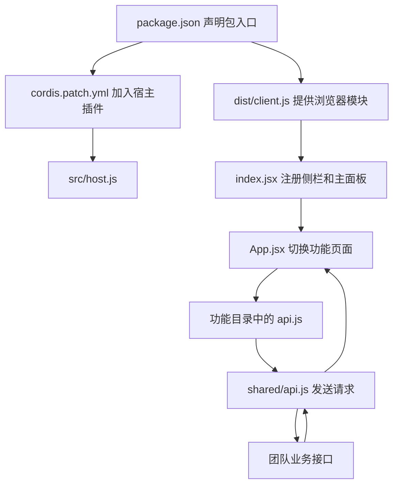

# EvoResearch 前端实现详解

核对日期为 2026 年 11 月 21 日。代码在 `evo/front-end panel`，个人说明文档在 `evo/personal docs`。下文省略前缀的 `features/` 和 `shared/` 路径，都从 `front-end panel/src/client/` 开始查找。

这套前端使用 React 写页面，通过 DSH 的插槽显示在宿主里，再用 HTTP 接口读取业务模块的数据。页面已经配置 F4 知识库、F8 实验过程、F9 指标图表、F13 预警与终止的调用。真实数据和操作结果要由相应后端返回。

建议先读第 1、2、4 节，理解页面怎么出现、一次请求怎么走。第 3 节说明安装配置，第 5 至 9 节逐个解释源码，第 10、11 节说明被 Git 忽略的文件。

## 1. 先认清运行时的几部分

| 名称 | 在哪里运行 | 在这套代码里做什么 |
| --- | --- | --- |
| 浏览器 | 打开 DSH 的 Edge 等浏览器 | 执行 React 页面，处理点击、输入、请求、图表和实时事件 |
| DSH 宿主 | 本机 Node.js 进程 | 加载插件、提供窗口布局与共享 React、处理登录和业务模块的路由 |
| 业务后端 | 团队各模块接入 DSH 后运行 | 查知识库、查实验、保存规则、执行远程终止，再返回结果 |
| 构建脚本 | 开发时在终端运行 | 把拆开的前端源码打包成 DSH 能加载的文件 |

`front-end panel/src/host.js` 当前导出一个插件名和空的 `apply()`。它让这个包具有宿主入口，包中的客户端声明再让 DSH 找到前端。知识库和实验的 HTTP 路由需要由团队业务模块提供。

### 页面第一次打开的顺序

1. 在 `front-end panel` 中运行 `npm ci`，安装本地构建依赖。
2. 运行 `npm run build`，执行构建脚本，生成 `dist/client.js`。
3. 把当前包添加到 DSH 的 Web profile，再启动 DSH。
4. DSH 根据包的 `dsh.bundle` 读取 `cordis.patch.yml`，加载宿主入口。
5. DSH 根据 `dsh.client` 和 `exports["./client"]` 找到客户端构建文件。
6. 客户端执行 `index.jsx` 中的注册逻辑，侧栏出现 EvoResearch。
7. 点击侧栏后，DSH 渲染 `Panel`，它放入样式和 `App`。
8. `App` 默认显示知识库，页面开始请求知识库列表。



DSH 中注册的是一个 EvoResearch 侧栏入口。六个功能入口由 `App.jsx` 在这个入口内部切换。

## 2. 文件夹为什么这样划分

```text
evo/
├─ personal docs/
│  ├─ 前端实现详解.md
│  ├─ 前端数据接入说明.md
│  └─ 新增接口设计.md
├─ .dsh-panel/                    本地 DSH 配置、凭据和会话，Git 忽略
└─ front-end panel/
   ├─ README.md                   安装、构建和启动
   ├─ .gitignore
   ├─ package.json
   ├─ package-lock.json
   ├─ cordis.patch.yml
   ├─ scripts/
   │  └─ build-client.mjs
   ├─ checks/
   │  ├─ contracts.test.js
   │  └─ debug-api.test.js
   ├─ src/
   │  ├─ host.js
   │  └─ client/
   │     ├─ index.jsx
   │     ├─ App.jsx
   │     ├─ styles.js
   │     ├─ shell/                 AppSettings.jsx、PanelIcon.jsx
   │     ├─ debug/                 enabled.js、disabled.js、fixtures.js
   │     ├─ shared/
   │     │  ├─ api.js
   │     │  ├─ hooks.js
   │     │  ├─ events.js
   │     │  ├─ useEvents.js
   │     │  ├─ TaskSelector.jsx
   │     │  └─ ui.jsx
   │     └─ features/
   │        ├─ knowledge/
   │        │  ├─ KnowledgePage.jsx
   │        │  └─ api.js
   │        ├─ process/
   │        │  ├─ ProcessPage.jsx
   │        │  └─ api.js
   │        ├─ metrics/
   │        │  ├─ MetricsPage.jsx
   │        │  ├─ MetricChart.jsx
   │        │  ├─ chart.js
   │        │  └─ api.js
   │        ├─ experiment-setup/   ExperimentSetupPage.jsx、api.js
   │        ├─ knowledge-graph/    KnowledgeGraphPage.jsx、api.js
   │        └─ alerts/
   │           ├─ AlertsPage.jsx
   │           └─ api.js
   ├─ dist/                       构建生成，Git 忽略
   └─ node_modules/               安装生成，Git 忽略
```

`src` 放手写的程序，`client` 放浏览器端代码。宿主入口位于 `src/host.js`，这样以后可以分别理解浏览器和 Node.js 端的职责。

`features` 按功能划分。改知识库，就从 `knowledge` 找页面和接口。改预警，就去 `alerts`。功能页面和对应的 `api.js` 放在一起，方便核对按钮会调用哪个接口。

`shared` 放多个功能都要用的能力，包括请求、加载状态、分页、任务选择和事件连接。已接入业务的页面共用这些规则，因此登录失效、请求失败和事件去重的处理会一致。

`scripts` 放开发时执行的构建程序。`checks` 放验证代码。`dist` 放构建结果，DSH 实际加载这里的客户端文件。`personal docs` 放理解、运行和联调时需要的个人文档。

当前源码使用 JavaScript 和 JSX。`.jsx` 允许在 JavaScript 中写类似 HTML 的界面表达式，构建时会转换成 React 调用。这个原型用 esbuild 构建。

## 3. 包、配置和构建文件

### 3.1 `front-end panel/package.json`

这个文件告诉 npm 和 DSH 怎样使用当前包。

| 配置 | 当前含义 |
| --- | --- |
| `name` | 包名 `evoresearch-front-end-panel`，构建和客户端加载器也使用这个名字 |
| `private: true` | npm 把它视为私有开发包 |
| `type: "module"` | Node.js 按 ESM 读取这个包的 JavaScript，可以使用 `import` 和 `export` |
| `exports["."]` | 宿主入口为 `./src/host.js` |
| `exports["./client"]` | 浏览器入口为 `./dist/client.js` |
| `files` | 打包时包含宿主入口、`dist` 和 DSH patch |
| `dsh.bundle.patch` | DSH 安装时读取 `cordis.patch.yml` |
| `dsh.client.platform` | 声明这个包带有 Web 客户端部分 |
| `engines` | Node.js 下限为 22.19.0，DSH 锁定为 0.2.1-rc.2 |
| `scripts.build` | `npm run build` 执行 `scripts/build-client.mjs` |
| `scripts.build:debug` | 生成可手动启用本地样例的构建 |
| `scripts.prepack` | 打包前重建普通版，避免把样例打包 |
| `scripts.test` | `npm test` 执行 `checks/*.test.js` |
| `devDependencies` | 本地安装 esbuild 和 React，供构建和开发使用 |

浏览器真正使用的 React 由 DSH 提供。构建脚本把 `react` 和 `react/jsx-runtime` 列为 external，因此构建产物中的这两项请求由宿主解析。

### 3.2 `front-end panel/package-lock.json`

它由 npm 生成，记录依赖实际解析到的版本、下载地址和完整性校验值。`package.json` 写允许使用的版本范围，lockfile 记录这次安装选定的版本。换一台电脑运行 `npm ci`，npm 会按这份记录安装。

文件里有多个操作系统的 esbuild 可选包。当前 Windows 安装会使用适合本机的二进制包，其他平台的记录仍可能出现在锁文件里。

### 3.3 `front-end panel/cordis.patch.yml`

当前内容是在 DSH 插件树中插入名为 `evoresearch-front-end-panel` 的包。这里的 `id` 标识这条插件配置，`name` 用于解析插件包。

安装命令负责把包加入 profile。这个 patch 则说明，包加入后要激活哪个插件。

### 3.4 `front-end panel/src/host.js`

当前导出 `name` 和 `apply()`。`apply()` 的函数体为空，所以这里当前只提供可加载的宿主插件入口。

宿主不提供模拟路由。普通模式把知识库、实验和预警请求直接交给配置的业务接口。将来接入后端时，可以由团队的宿主插件提供这些路由。

### 3.5 `front-end panel/scripts/build-client.mjs`

构建过程有几个明确的步骤。

1. 根据脚本所在位置找到 `front-end panel` 根目录。
2. 读取 `package.json` 的包名。
3. 从 `src/client/index.jsx` 开始，沿 `import` 把前端模块收集起来。
4. 转换 JSX，把模块打包为 CJS 格式的客户端内容。
5. 保留 `react` 和 `react/jsx-runtime` 为宿主模块请求。
6. 在构建内容前后加上 DSH 加载包装。
7. 写出 `dist/client.js` 和 `dist/client.js.map`。

DSH 包装的核心是下面这段形式，实际文件还包含完整的打包代码。

```javascript
window.__ModuleLoader__.load({
  id: "evoresearch-front-end-panel",
  factory: (require) => {
    var module = { exports: {} }
    var exports = module.exports
    // esbuild 生成的代码
    return module.exports
  }
})
```

`factory` 接收 DSH 提供的 `require`，构建内容通过它取得共享 React。运行后返回客户端导出的 `apply` 和 `inject`。

代码拆成许多文件，是为了方便开发。构建后由 DSH 加载一个客户端入口。修改源码后，需要重新构建才能让 DSH 读到新内容。

## 4. 页面总入口和公共请求

### 4.1 `src/client/index.jsx`

这个文件负责把应用放进 DSH。

`inject = ['slots']` 声明需要宿主的插槽服务。`apply(ctx)` 进行两次注册。

| 插槽 | 注册内容 | 作用 |
| --- | --- | --- |
| `main` | `key = panelId` 和 `Panel` 组件 | 告诉 DSH 这个面板显示什么 |
| `sidebar.panellist` | `id = panelId`、显示文字、图标 | 在侧栏加入 EvoResearch 入口 |

两个位置使用相同的 `panelId`，侧栏才能打开对应的主面板。`Panel()` 渲染一个样式标签和 `App`。`Icon()` 返回侧栏里的简单字符图标。

`slots.inject()` 让注册跟随宿主插槽的可用状态。插件退出时，相关插槽贡献跟随插件生命周期移除。

### 4.2 `src/client/App.jsx`

`App` 管理整个前端中需要共用的状态。

| 状态 | 用途 |
| --- | --- |
| `panelId` | 当前显示的功能页面 |
| `taskId` | `Workspace` 管理的任务编号，由三个实验页面共用 |
| `prefix` | 当前生效的接口前缀 |
| `theme` | 跟随 DSH、浅色或夜间 |
| `debug` | 调试构建中是否使用本地样例，默认关闭 |

页面上的导航修改 `panelId`，React 根据 `panels` 找到标题、图标和组件。各页面单独保留自己的代码。

接口前缀保存在浏览器的 `localStorage`，键名为 `evoresearch.apiPrefix`。打开页面时先读它，读取失败或没有保存值时使用 `evoresearch/api/`。

文件内部的 `Workspace` 创建公共 `api` 对象，展示任务选择器，并持有实时事件连接。切换 F8、F9、F13 时，它们共用所选 `taskId` 和事件流。离开这三个页面时，传给 `useEvents` 的任务编号变为空，事件连接随之关闭。

切换真实与调试数据，或改变生效的真实接口前缀时，React 会重建 `Workspace` 并清理旧请求和事件连接。各实验页使用 `key={taskId}`，切任务时会重建该页的局部状态。

任务编号放在 `Workspace` 中，同一数据来源内切换页面会保留。页面自己的搜索、筛选和表单状态放在功能组件里，离开该页后会随组件卸载而重置。

### 4.3 `src/client/shared/api.js`

这个文件负责实际发送 HTTP 请求，几个函数分工如下。

| 函数 | 具体行为 |
| --- | --- |
| `apiBase()` | 用 DSH 页面的 `document.baseURI` 解析接口前缀，检查协议和同源条件，补齐末尾的斜杠 |
| `createApi()` | 为接口前缀创建 `url()`、`request()`、`openEvents()`；调试版传入内存传输层 |
| `url()` | 把相对路径拼到前缀后面，再加入查询参数，跳过空字符串和空值 |
| `request()` | 发请求、检查登录和响应、解析 JSON，最后返回响应里的 `data` |
| `arrayField()` | 检查后端是否返回预期的数组，比如 `entries` 或 `series` |
| `taskPath()` | 校验正整数任务编号，生成 `experiments/{id}` |

默认 DSH 页面在根目录时，请求 `kb/entries` 会形成 `/evoresearch/api/kb/entries`。如果页面在 `/ui/` 下，默认路径会跟随为 `/ui/evoresearch/api/kb/entries`。用户也可以在设置里填以斜杠开头的根目录前缀。

每条请求使用 `credentials: 'same-origin'`，浏览器会携带当前宿主的同源凭据。路由提供方仍须在服务端检查 DSH 身份和业务资源归属。

GET 把筛选条件放在 URL 中。PUT、POST、DELETE 使用 JSON 请求体，并要求提供 `idempotency_key`。这个键由 `useMutation` 产生，用来让后端识别同一次操作的重试。

`request()` 先处理 HTTP 401、403，再检查 Content-Type，最后检查 `{code, message, data}`。接口返回网页时会提示接口尚未接入或格式错误。后端返回失败的业务码时，页面显示其 `message`。成功后，页面拿到的是 `data` 内的内容。

### 一次知识库详情请求的完整顺序

```text
用户点击一个列表条目
  → KnowledgePage 把 selected 改成该条目的 document_id
  → EntryDetail 用新的 id 加载详情
  → knowledge/api.js 调用 knowledgeApi.detail()
  → shared/api.js 拼好地址并执行 fetch
  → 知识库后端检查身份并查询条目
  → request() 检查响应，取出 data
  → useResource 保存 data
  → React 重新渲染标题、来源、正文和编辑表单
```

## 5. 公共状态、事件和组件

### 5.1 `src/client/shared/hooks.js`

这个文件有三个 React Hook。Hook 是组件调用的函数，用于复用带状态和生命周期的逻辑。

`useResource(load, dependencies)` 用来读取数据。首次显示或依赖改变时，它创建 `AbortController`，设置加载状态，再执行传入的 `load(signal)`。成功保存 `data`，失败保存错误文字。`refresh()` 增加重试次数，使请求重新执行。

依赖和重试次数组成 `signature`。页面只显示与当前条件匹配的响应。组件卸载或条件改变时，清理函数取消旧请求，响应回调还会检查取消标记。刷新开始后，当前展示切换到加载状态。

`useMutation()` 用来保存、删除和终止。调用方给出动作标识 `identity` 和实际请求函数。它生成 UUID 幂等键，并用 `active` 标记正在执行的操作，防止连续点击并发发送。同一组件内，同样动作和内容失败后重试会保留原键，成功后清除，下次操作生成新键。动作或请求内容改变时也会换键。

幂等键存在内存中，组件卸载后结束这段保留。后端对重复执行、重启恢复和事务一致性的处理，需要由业务服务实现。

`useEventRevision(events)` 观察最后一条事件的序号。有新序号时，约一秒后增加 `revision`，同一等待期间合并后续变化。功能页面把 `revision` 放进读取依赖，于是可以重新查轮次、指标或状态。这能控制事件密集时的刷新频率。

### 5.2 `src/client/shared/events.js`

`eventTypes` 列出六类事件，包括 `run_status`、`log`、`metric`、`decision`、`alert`、`finish`。

`mergeEvents()` 检查任务编号、正整数序号和事件类型，把事件放进按 `seq` 为键的 Map。重复序号覆盖同一个位置，最终按序号升序返回。它也会拒绝其他任务的事件，避免混进当前页面。

`loadHistory()` 调用 `GET /experiments/{id}/events`，每页请求 100 条，按 `next_cursor` 继续读，直到分页结束。每页数据经过合并和排序。后端重复返回同一个游标时，它会停止并报告错误，防止无限请求。

### 5.3 `src/client/shared/useEvents.js`

它把历史回放和实时推送接起来。

1. 任务确定后，先调用 `loadHistory()`。
2. 找到历史事件里最大的 `seq`，没有历史时使用 0。
3. 创建 `EventSource`，连接 `/events/stream?since=...`。
4. 为六种事件类型分别注册监听。
5. 检查 SSE 的 `event`、`id` 是否与 JSON 中的 `type`、`seq` 一致。
6. 调用 `mergeEvents()` 去重排序，然后更新页面状态。

浏览器处理 SSE 的自动重连和 `Last-Event-ID`。服务端需要正确补发断点之后的事件。

连接失败时显示重连提示。事件格式不一致时关闭当前连接并显示错误，用户可以点“重新连接”。切任务、换接口前缀或离开实验页面时，取消历史请求并关闭 SSE。

状态中带有对应的 `taskId`，展示前再核对一次，切换任务期间会先显示新任务的加载状态。

### 5.4 `src/client/shared/TaskSelector.jsx`

任务选择器请求 `GET /experiments?cursor=...&limit=20`，检查 `data.tasks`，把任务标题和状态放进下拉框。`Pager` 根据 `next_cursor` 翻页。

它还提供任务编号输入框。任务列表接口暂时不可用时，开发者仍可输入已知的正整数任务编号，尝试调用该任务的具体接口。选择结果通过 `onChange` 交给 `App` 保存。

### 5.5 `src/client/shared/ui.jsx`

| 组件 | 负责什么 |
| --- | --- |
| `Feedback` | 显示读取中、写入中、错误、重试按钮和成功提示 |
| `Pager` | 使用游标历史提供上一页和下一页，最后一页禁用下一页 |
| `ObjectView` | 普通值按文本显示，对象和数组按可展开阅读的 JSON 文字显示 |
| `Value` | 缺失值显示“—”，正常值如 0 会保留 |

这些组件统一了各页面的基本显示行为。正文和事件 payload 目前通过 `ObjectView` 展示后端返回的对象，具体字段确认后可以进一步设计专用卡片。

## 6. F4 知识库的两个文件

### 6.1 `features/knowledge/api.js`

它集中定义四个请求。

| 方法 | HTTP 请求 | 页面用途 |
| --- | --- | --- |
| `list()` | GET `kb/entries` | 读取列表，检查 `entries[]` |
| `detail()` | GET `kb/entries/{id}` | 读取详情 |
| `update()` | PUT `kb/entries/{id}` | 修改标题或备注 |
| `remove()` | DELETE `kb/entries/{id}` | 删除条目 |

请求通过公共 `api.request()` 发送，路径中的条目编号会编码。这里集中保留了接口路径和方法，后端约定变化时容易找到修改位置。

### 6.2 `features/knowledge/KnowledgePage.jsx`

同一个文件里有三个组件。

`KnowledgePage` 管理左边的列表和右边的详情区域。它保存搜索框内容、已提交的筛选条件、分页游标、当前条目和勾选编号。

搜索框内容保存在 `search`，点击搜索才写进 `query`。因此输入每个字时页面只更新输入框，提交时才按新关键词请求。类型筛选直接更新 `query.type`。筛选变化会回到第一页并清空当前详情。

每次列表请求带 `limit=20`，使用 `data.nextCursor` 翻页。列表按后端给的顺序显示标题、类型和创建时间。

勾选动作只更新内存中的 `checked` 数组，并显示选中数量和编号。当前勾选状态用于页面选择，还没有接入批量删除或 F12 对话引用。它可以跨当前列表的翻页和筛选保留，成功修改或删除后会清空。

`EntryDetail` 使用选中的编号请求详情。换条目时，组件的 key 改变，旧请求和表单随之卸载，新条目重新加载。

`Editor` 展示类型、来源编号、正文对象，并提供标题和备注输入。保存时发送处理过的标题，备注发生变化才加入 `user_note`。删除前弹出确认框，再执行 DELETE。保存和删除成功后，会清空当前详情并刷新列表。

备注的读回字段和清空语义仍属于[新增接口设计](新增接口设计.md)里的待确认部分。

## 7. F8 实验过程的两个文件

### 7.1 `features/process/api.js`

当前定义 `runs()`，请求 `GET /experiments/{id}/runs` 并检查 `data.runs[]`。历史事件和 SSE 在公共事件模块中完成，所以这里专门放轮次读取。

### 7.2 `features/process/ProcessPage.jsx`

页面上半部把 `runs[]` 显示成表格，包括轮次、运行编号、状态、调试深度和创建时间。

下半部使用传入的 `stream.events`。全流程时间线显示全部事件，决策摘要筛选 `type=decision`，实验日志筛选 `type=log`。运行编号和内容搜索继续在已读取的事件上筛选。每条事件展开后显示 `payload`。

这里的时间线按全局序号排列。步骤名称取 `step`，运行编号取 `runId`。当前还没有从 payload 提取步骤起止时间来计算耗时，也没有画独立的流程节点连线。

页面通过 `useEventRevision` 在新事件到来时刷新轮次表。决策内容显示的是后端提供的决策摘要。

## 8. F9 指标图表的四个文件

### 8.1 `features/metrics/api.js`

| 方法 | HTTP 请求 | 返回中的主要内容 |
| --- | --- | --- |
| `series()` | GET `/experiments/{id}/metrics` | `series[]` 指标序列 |
| `candidates()` | GET `/experiments/{id}/candidates` | `candidates[]` 和 `next_cursor` |
| `certification()` | GET `/experiments/{id}/certification` | 数量统计和 `items[]` |

### 8.2 `features/metrics/MetricsPage.jsx`

页面保存正在输入的查询条件 `params` 和已经提交的条件 `filters`。点击查询时复制条件，读取相应的数据。默认数据划分是验证集 `val`，也可以选择训练集或测试集。

指标按 `name + split` 分组，每一组交给一个 `MetricChart`。原始数值表保留运行编号、指标名、划分、epoch、global_step、seed、数值和时间，便于核对图上的点。

候选表显示验证指标、标准差、种子数、认证状态和测试指标。验证指标优先读取 `val_metric_mean`，缺省时使用 `val_metric`。后端缺少可选统计值时显示“—”。

认证区域显示总数、已认证、失败、待认证数量，以及每个候选的认证状态。测试集可见性由后端执行，前端按它返回的字段展示。

### 8.3 `features/metrics/chart.js`

`chartLines()` 把指标序列整理成可绘图的折线。

同一张图的所有点都有有效 `epoch` 时使用它作为横轴，否则尝试统一使用 `global_step`。统一坐标仍不成立时返回空折线列表，页面提示查看原始数值。

每个后端序列再按 `seed` 分开，横坐标排序后生成 `{x, y}` 点。不同随机种子各自成线，图例保留运行编号和种子信息。缺少有效数值的点跳过。

### 8.4 `features/metrics/MetricChart.jsx`

这个文件用浏览器 Canvas 画图。

它从 `chartLines()` 取得折线，计算所有点的横纵坐标范围，然后把业务坐标映射到画布像素。先画网格和坐标文字，再为各条线选颜色，连线并画出每个点。

当全部横坐标或纵坐标相同，绘图范围会稍作扩展，让坐标换算保持有效。变化的是显示范围，原始点的数值保持按接口数据绘制。

画布高度为 240 像素，实际像素尺寸按屏幕像素比放大。宽度变化由 `ResizeObserver` 观察并重绘，组件卸载时停止观察。图下方提供图例，页面另有原始数值表供核对。

## 9. F13 预警与终止的两个文件

### 9.1 `features/alerts/api.js`

| 方法 | HTTP 请求 | 状态 |
| --- | --- | --- |
| `rules()` | GET `/experiments/{id}/alert-rules` | 本次推测新增的读取接口 |
| `save()` | PUT 同一路径 | 沿用契约的整组保存 |
| `stop()` | POST `/experiments/{id}/stop` | 沿用契约 |
| `task()` | GET `/experiments/{id}` | 查询后端任务状态 |

### 9.2 `features/alerts/AlertsPage.jsx`

`AlertsPage` 读取已有规则和任务详情。已有规则成功返回后才显示 `RulesEditor`，避免读取失败时把未知的旧规则当成空数组提交。

`RulesEditor` 为每条规则显示指标、阈值、方向、数据划分、提醒频率、通知方式和启用开关。添加规则只建立用户正在编辑的表单草稿。选择按周期提醒时显示 `interval_seconds` 输入框。

提交时校验指标名称、有限数值阈值和正整数周期秒数，把输入框中的数字文字转成数值，然后整组发送 `rules[]`。已有规则保留 `rule_id`，新增规则交给服务端分配编号。空数组提交前会确认是否清空全部规则。保存成功后重新读取。

终止按钮调用 `stop()`。随后页面查询任务详情，并每三秒再次核对，直到当前查询得到“已终止”或“已完成”。即使终止请求的响应失败，也会开始核对，因为请求可能已到达服务端。任务状态始终从 `task()` 的响应读取。

预警记录从公共事件流里筛选 `type=alert` 展示。当前页面具备规则编辑、记录查看和终止操作。阈值命中判断、预警落库、弹窗或邮件通知需要界面子系统后端继续接入。

## 9.1 本次增加的独立模块

- `shell/AppSettings.jsx` 放接口配置、外观选择和调试数据开关。调试版的开关直接显示在导航下方，无需展开接口设置。窄面板里工具栏可以换行。前缀和外观存到当前浏览器，调试开关状态只放内存。`shell/PanelIcon.jsx` 负责导航的线形图标。
- `debug/fixtures.js` 返回全新样例对象。`debug/enabled.js` 通过公共请求接口返回本地响应，并用内存事件源模拟已有事件协议。`debug/disabled.js` 是普通版入口，不引用样例。构建脚本选择入口，因此正式构建和打包产物都没有样例。
- `features/experiment-setup/ExperimentSetupPage.jsx` 和 `features/knowledge-graph/KnowledgeGraphPage.jsx` 只显示各自的预留内容。各目录的 `api.js` 对应正式实验草稿、确认、启动或图谱查询和节点详情，预留页面不主动调用。接口字段见[新增接口设计](新增接口设计.md)。

## 10. 样式、测试和被 Git 忽略的构建文件

### 10.1 `src/client/styles.js`

样式以字符串导出，由 `index.jsx` 的 `style` 标签插入页面。CSS 选择器以 `.evo-app` 开头，把作用范围限制在当前应用内。

页面结构使用 Grid 和 Flex。DSH 的主栏会裁剪超高内容，因此 `.evo-app` 使用宿主分配的高度，并负责整块面板的滚动。导航按内容区宽度排列为六列、三列或两列，知识库在内容区小于 760 像素时切换为单列，宽表格在卡片内横向滚动。跟随 DSH 时使用宿主的底色、文字色、边框和字体；手动切换昼夜时使用面板自己的色板。蓝色用于选中态和主要操作，状态标签同时显示文字。Canvas 曲线在主题变化时重画，图例用颜色和线型对应不同的运行曲线。

现在全部样式集中在这一文件，功能组件和接口已经按目录拆开。增加具体功能样式时，需要继续使用前缀控制作用范围。

### 10.2 `checks/contracts.test.js`

这个文件包含六项检查。

| 检查 | 解决的问题 |
| --- | --- |
| 地址前缀和任务路径 | 保留 DSH 子目录，拒绝错误来源和无效任务编号 |
| 写请求 | 保留 DELETE 的 JSON 请求体、同源凭据和调用方传入的重试键 |
| 错误响应 | 401、HTML 404 等情况能形成可显示的错误 |
| 事件回放 | 重复事件去重、跨任务拒绝、分页游标重复时终止 |
| 图表数据 | 不同种子分线，缺少统一坐标时返回无法绘制 |
| DSH 客户端构建 | 打包文件能注册相同 ID 的侧栏和主面板 |

`contracts.test.js` 检查普通契约和打包入口。`debug-api.test.js` 检查样例分页、写入隔离、事件与终止状态，以及两个预留模块的适配路径。包加载检查需要先生成 `dist/client.js`，所以先构建，再运行 `npm test`。

### 10.3 `front-end panel/.gitignore`

这里忽略 `node_modules/`、`dist/` 和面板目录里的本地 DSH 运行目录（旧名 `.dsh-test/` 或误建的 `.dsh-panel/`）。源码、`package.json`、`package-lock.json`、构建脚本和测试文件仍可由 Git 跟踪。

Git 忽略和 npm 打包是两套规则。`dist` 被 Git 忽略，但 `package.json.files` 把它列入安装包。使用本地链接开发时，DSH 直接读取本机已经构建出来的文件。

### 10.4 `front-end panel/dist/client.js`

这是 esbuild 根据全部前端源码生成的文件，带有 DSH 模块加载包装。DSH 从这个入口执行页面逻辑。

日常修改对应的源码文件，再运行构建更新它。只从仓库拿到源码时，需要先构建，才能得到宿主期望的客户端入口。

### 10.5 `front-end panel/dist/client.js.map`

这是源码映射文件。打包后的一段代码可能来自 `App.jsx`，也可能来自某个功能页。浏览器开发者工具用这个映射把打包代码对应回原文件和行号，便于调试。

当前构建会把相关源码信息放进 map。分发构建产物时，map 也在 `dist` 中。

## 11. 被 Git 忽略的依赖和 DSH 运行文件

这一节根据当前机器实际目录核对。安装依赖和运行 DSH 后，文件集合可能变化。配置和凭据这里只说明用途。

### 11.1 `front-end panel/node_modules`

这个目录由 `npm ci` 或 `npm install` 生成。它属于开发环境，包含本地构建工具及其依赖。

| 当前文件或路径 | 用途 |
| --- | --- |
| `.package-lock.json` | npm 写在安装目录中的内部锁定资料，用于维护已安装依赖状态 |
| `.bin/esbuild`、`esbuild.cmd`、`esbuild.ps1` | 为不同命令环境提供 esbuild 启动入口，npm 脚本能据此找到构建工具 |
| `.bin/loose-envify`、`loose-envify.cmd`、`loose-envify.ps1` | loose-envify 工具的命令入口 |
| `@esbuild/win32-x64/esbuild.exe` | 本机 Windows x64 的实际构建程序 |
| `@esbuild/win32-x64/package.json`、`README.md` | 二进制依赖包的版本和说明 |
| `esbuild/bin/esbuild` | esbuild 的命令行启动脚本 |
| `esbuild/install.js` | 安装时查找并准备平台二进制 |
| `esbuild/lib/main.js` | Node.js 构建 API，构建脚本通过它执行 `build()` |
| `esbuild/lib/main.d.ts` | 构建 API 的类型声明，供编辑器和类型工具使用 |
| `esbuild/package.json`、`README.md`、`LICENSE.md` | 依赖元信息、说明和许可证 |
| `js-tokens/index.js` | 把 JavaScript 文本识别为词法单元，供相关工具处理代码 |
| `js-tokens/package.json`、`README.md`、`CHANGELOG.md`、`LICENSE` | 这个依赖的元信息、说明、变更记录和许可证 |
| `loose-envify/index.js`、`loose-envify.js` | 为工具处理环境变量表达式 |
| `loose-envify/replace.js`、`custom.js`、`cli.js` | 替换逻辑、定制入口和命令行入口 |
| `loose-envify/package.json`、`README.md`、`LICENSE` | 依赖元信息、说明和许可证 |
| `react/index.js` | 本地 React 包的公共入口 |
| `react/jsx-runtime.js`、`jsx-dev-runtime.js` | JSX 运行入口的包装文件 |
| `react/react.shared-subset.js` | React 包提供的其他入口 |
| `react/cjs/*` | React 的 CJS 实现，具体版本见下表 |
| `react/umd/*` | React 提供的 UMD 版本，供相应加载环境使用 |
| `react/package.json`、`README.md`、`LICENSE` | React 的元信息、说明和许可证 |

当前 `react/cjs` 内的文件按以下用途分组。

| 文件 | 用途 |
| --- | --- |
| `react.development.js` | 带开发检查和提示的 React |
| `react.production.min.js` | 生产优化版本 |
| `react-jsx-runtime.development.js`、`react-jsx-runtime.production.min.js`、`react-jsx-runtime.profiling.min.js` | JSX runtime 的开发、生产和性能分析版本 |
| `react-jsx-dev-runtime.development.js`、`react-jsx-dev-runtime.production.min.js`、`react-jsx-dev-runtime.profiling.min.js` | 开发 JSX 入口的对应版本 |
| `react.shared-subset.development.js`、`react.shared-subset.production.min.js` | shared subset 入口的开发和生产版本 |

`react/umd` 当前包含 `react.development.js`、`react.production.min.js`、`react.profiling.min.js`，分别是开发、生产和性能分析版本。当前 DSH 客户端构建通过 external 使用宿主 React，这些本地文件供开发依赖和工具解析。

### 11.2 `evo/.dsh-panel`

它是运行说明中通过 `DSH_HOME` 指定的测试宿主资料目录。这里包含 DSH 的 profile、凭据和会话状态。

| 当前文件或路径 | 用途 |
| --- | --- |
| `.anonymous-user-id` | DSH 保存的匿名标识文件 |
| `.credentials.yaml` | DSH 的本地凭据记录。当前浏览器登录机制会用到宿主保存的签名材料 |
| `profiles/web/package.json` | Web profile 的依赖和 bundle 列表，包含指向 `evo/front-end panel` 的本地链接 |
| `profiles/web/cordis.yml` | DSH 自动维护的空根配置，插件树由各 patch 组合 |
| `profiles/web/cordis.patch.yml` | 这个 profile 的本机覆盖设置，当前有欢迎说明的确认版本 |
| `profiles/web/pnpm-lock.yaml` | profile 依赖安装使用的 pnpm 锁定文件 |
| `profiles/web/pnpm-workspace.yaml` | profile 的 pnpm 工作区与依赖布局设置 |
| `profiles/web/node_modules/.modules.yaml` | pnpm 记录依赖布局和安装状态 |
| `profiles/web/node_modules/.pnpm-workspace-state-v1.json` | pnpm 保存的工作区状态 |
| `profiles/web/node_modules/.pnpm/` | pnpm 使用的依赖布局目录 |
| `profiles/web/node_modules/evoresearch-front-end-panel` | 指向当前 `evo/front-end panel` 的目录链接 |
| `profiles/web/.plugin-manager/logs/operation-*/pnpm.log` | DSH 添加或管理插件时保存的安装日志 |
| `sessions/<工作区>/session-*/session.v4.jsonl.zstd` | DSH 保存的压缩会话记录 |
| `storages/session_projcache/sessions/session-*.json` | DSH 的会话与项目关联缓存 |
| `storages/workspace.json` | DSH 保存的工作区状态 |

会话目录名中的工作区路径和 UUID 由 DSH 生成，每次运行可能不同。插件安装操作日志使用 `pnpm.log`。

新版把 `.dsh-panel` 放在插件目录之外，插件链接不再回到 DSH 自己的运行目录。根 Git 忽略规则也保留了旧 `test/.dsh-test/`，避免迁移残留被跟踪。

### 11.3 根目录的忽略规则

`evo/.gitignore` 还影响仓库的其他文件。

| 规则 | 含义 |
| --- | --- |
| `AGENTS.md` 等名字 | 本机协作说明留在本地 |
| `/.dsh-panel/`、`/test/.dsh-test/` | 当前与旧版运行资料留在本地 |
| `*.doc`、`*.docx`、`*.docm`、`*.docs` | 新增的可编辑 Word 文档按本机约定忽略 |
| `~$*` | Word 等应用创建的临时文件 |
| `docs/**` 及后续例外 | `docs` 下新增普通文件会被忽略，PDF、目录和占位文件按例外保留 |

已被 Git 跟踪的文件仍会继续跟踪。忽略规则主要影响新增的未跟踪文件。

`personal docs` 当前没有专门的忽略规则，所以这里的 Markdown 会显示在 Git 的未跟踪列表中。本次整理没有创建提交。

### 11.4 浏览器保存的东西

接口前缀保存在浏览器的 localStorage 中，键名为 `evoresearch.apiPrefix`。这部分存储由浏览器管理，源码目录里找不到同名文件。

DSH 登录 Cookie 也由浏览器管理。前端请求通过同源凭据设置交给浏览器携带。源码无需读取凭据文件的内容。

## 12. 整理后的文档和以后修改的位置

| 文档 | 解决什么问题 |
| --- | --- |
| [前端实现详解](前端实现详解.md) | 每个文件如何工作，以及文件之间怎样协作 |
| [前端运行与目录说明](../front-end%20panel/README.md) | 安装、构建、测试和启动命令，与面板代码放在一起 |
| [前端数据接入说明](前端数据接入说明.md) | 每个页面显示什么、调用哪个接口、数据归谁提供 |
| [新增接口设计](新增接口设计.md) | 推测的规则读取接口、周期字段和其他待确认约定 |

运行说明位于面板目录的 `README.md`。实现详解和两份接口说明留在 `personal docs`。

| 想改什么 | 先看哪个文件 |
| --- | --- |
| 侧栏名称和图标 | `src/client/index.jsx` |
| 加一个功能页、改导航、共享任务状态 | `src/client/App.jsx` |
| 修改接口前缀校验、登录错误或响应外层 | `src/client/shared/api.js` |
| 某个业务接口的路径、方法和参数 | 对应 `features/<功能>/api.js` |
| 某个功能的按钮、表单、列表 | 对应功能的 Page 组件 |
| 修改图表坐标与种子分组 | `features/metrics/chart.js` |
| 修改画图和图例 | `features/metrics/MetricChart.jsx` |
| 修改事件回放、去重 | `shared/events.js` |
| 修改 SSE 连接和重连提示 | `shared/useEvents.js` |
| 修改样式 | `src/client/styles.js` |

新增页面时，在 `features` 下创建该功能目录和 `api.js`，写好页面组件，再加入 `App.jsx` 的导航数组和条件渲染。已有任务编号和公共请求可以继续复用。需要新接口时，先在“新增接口设计”中说明方法、字段、提供方和页面用途。

这份说明描述的是当前前端实现。页面实际发请求，业务后端完成后才能验证真实保存、删除、指标流和远程终止。F13 的阈值判定、通知发送和持久化仍归界面子系统后端接入，当前前端负责配置和展示。
